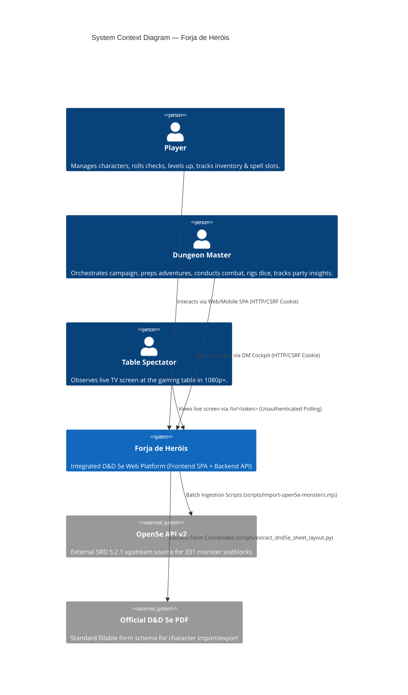
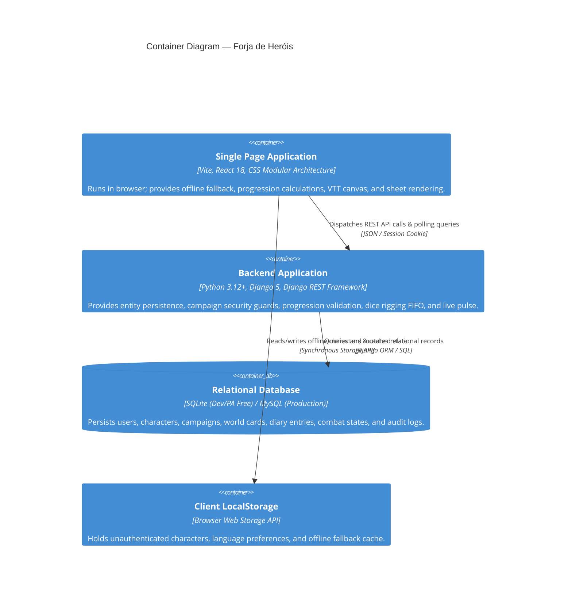

# Forja de Heróis — Master System Architecture Document

> **System Revision:** v2.8+ (D&D 5e 2024 / SRD 5.2.1 & 2014 Dual Engine)  
> **Status:** Production / Active Evolution  
> **Primary References:** `README.md`, `PRODUCT.md`, `DESIGN.md`, `DECISIONS.md`, `ADR.md`, `RULES.md`, `API.md`

---

## 1. Executive System Overview & Metaphor

**Forja de Heróis** is an offline-first, dual-edition (2024 / 2014) web platform for D&D 5e character creation, campaign management, tactical VTT combat, and live TV screen broadcasting. It reconciles three previously fragmented operational spaces into a unified real-time loop:

```
        ┌─────────────────────────────────────────────────────────┐
        │                  THE FORGE (Player App)                 │
        │  • 17-Step PHB 2024 Wizard ("Hold to Seal" Decisions)  │
        │  • Forged Leather Statblock (Hex Abilities & Dice Belt) │
        │  • 3-Page Editable Official PDF Roundtrip Engine        │
        └────────────────────────────┬────────────────────────────┘
                                     │ (Client Roll / State Sync)
                                     ▼
        ┌─────────────────────────────────────────────────────────┐
        │                 THE TABLE (DM Stage & Mesa)             │
        │  • 4 DM Areas: World, Prepare, Play, Party              │
        │  • Party Insights (11 Roles Radar & SWOT Intelligence)  │
        │  • VTT Combat Engine (331 SRD 5.2.1 Monsters + Tokens)  │
        │  • Server-Side Gated Dice Rigging FIFO Pipeline         │
        └────────────────────────────┬────────────────────────────┘
                                     │ (Stage Event Bus / HTTP 304 Pulse)
                                     ▼
        ┌─────────────────────────────────────────────────────────┐
        │                 THE SCREEN (Public TV View)             │
        │  • Zero-Auth Public Route (/tv/<screenToken>)           │
        │  • 1080p+ High-Contrast Living Stage (HP Bars, Combat)  │
        │  • Dramatic 3D/2D Dice Reveals (DM-Gated Public/Private)│
        └─────────────────────────────────────────────────────────┘
```

---

## 2. C4 Architecture Blueprint

### 2.1 C4 Level 1: System Context Diagram



### 2.2 C4 Level 2: Container Diagram



### 2.3 C4 Level 3: Component Decomposition (Frontend SPA)

The frontend SPA (`frontend/src/`) is segmented into decoupled domain modules:

```mermaid
graph TD
    subgraph Core ["Application Core & Infrastructure"]
        App["App.jsx (Root Router & Screen Switcher)"]
        AuthContext["src/auth/AuthContext.jsx"]
        StorageAdapter["src/api/storage.js (Local vs Remote Adapter)"]
        ApiClient["src/api/client.js (CSRF + REST Client)"]
        PulseSync["src/api/polling.js (Pulse & ETag Poller)"]
    end

    subgraph DomainEngines ["Domain Rules & Computational Engines"]
        ProgEngine["src/progression/engine.js (Idempotent 1-20 Progression)"]
        ProgRules["src/progression/rules.js (2024 & 2014 Descriptors)"]
        OptionsEngine["src/progression/options.js (Pools, Invocations, Metamagic)"]
        MetricsEngine["src/metrics/party-metrics.js (11 Roles Radar & SWOT)"]
        DiceEngine["components/DiceRoller.jsx & src/dice/"]
        PdfEngine["src/pdf/export-pdf.js & import-pdf.js"]
    end

    subgraph UIModules ["Presentation & User Interaction"]
        Wizard["src/creator/CreatorWizard.jsx (17-Step Journey)"]
        Sheet["components/Sheet.jsx & src/sheet/ (Forged Panel)"]
        MesaShell["src/shell/ (4 DM Areas / 4 Player Areas)"]
        VttCombat["src/combat/ & src/campaigns/CombatTab.jsx"]
        LivingWorld["src/world/ (Atlas, Cards, Echoes)"]
        StageTv["src/screen/TVScreen.jsx (Living Stage View)"]
    end

    App --> AuthContext
    App --> StorageAdapter
    App --> MesaShell
    App --> Sheet
    App --> Wizard
    App --> StageTv

    MesaShell --> VttCombat
    MesaShell --> LivingWorld
    MesaShell --> MetricsEngine

    Sheet --> ProgEngine
    Sheet --> PdfEngine
    Sheet --> DiceEngine

    Wizard --> ProgRules
    Wizard --> OptionsEngine

    StorageAdapter --> ApiClient
    PulseSync --> ApiClient
```



---

## 3. Core Domain Engines & Mechanics

### 3.1 Dual-Rules Progression Engine (`rulesVersion: '2024' | '2014'`)
The engine in `frontend/src/progression/engine.js` guarantees deterministic, idempotent character advancement.
- **2024 Revision (SRD 5.2.1 / PHB 2024):** Subclasses activate at level 3 for all 12 classes; attribute score increases derive from Backgrounds; Origin Feats are granted at Level 1; Weapon Masteries and dynamic option pools are enforced.
- **2014 Revision (SRD 5.1):** Subclasses activate at class-specific levels (e.g., Cleric/Warlock at Level 1, Wizard/Druid at Level 2); racial ability score modifiers apply; legacy subraces and spell slots are observed.
- **Idempotency Invariant:** `applyAutosToCharacter(char)` can be executed $N$ times without duplicating features or spell grants. Switching a subclass cleanly strips former automatic features and injects new ones.
- **Server-Side Verification:** An identical Python port in `backend/api/progression/` independently verifies all level-up requests prior to granting level increases.

### 3.2 Party Tactical Insights Engine (`party-metrics.js`)
The GM Intelligence system calculates party performance across 11 distinct tactical vectors:
1. **Damage (`damage`)**: Melee/ranged DPR potential, cantrip scaling, damage rider abilities.
2. **Mitigation (`mitigation`)**: AC curve, effective HP pool, resistances/immunities, defensive features.
3. **Magic Capacity (`magic`)**: Total spell slot volume, max spell tier, spell versatility.
4. **Healing (`healing`)**: Hit point restoration, revival capabilities, regeneration pools.
5. **Ranged (`ranged`)**: Weapon range $\ge 30\text{ ft}$, ranged spell attacks, flight engagement.
6. **Melee (`melee`)**: Close-quarters attack capability, reach weapons, front-line durability.
7. **Control (`control`)**: Hard/soft crowd control, forced movement, condition inflicters.
8. **Utility (`utility`)**: Ritual casting, tool masteries, problem-solving spells.
9. **Mobility (`mobility`)**: Base speed $> 30\text{ ft}$, teleportation, traversal spells (Fly, Misty Step).
10. **Social (`social`)**: Charisma baseline, persuasion/deception/intimidation modifiers, charm magic.
11. **Exploration (`exploration`)**: Passive Perception, Survival, Stealth, darkvision, navigation features.

**SWOT Generation Logic:**
- **Strengths:** Evaluates party best $\ge 4.0$ in any role.
- **Weaknesses:** Evaluates party best $\le 2.0$ or severe saving throw deficiencies.
- **Opportunities:** Discovers high-margin skill proficiencies ($+7$ or higher) to suggest tailored encounter challenges.
- **Threats:** Cross-correlates party damage types with `data/bestiary.js` to identify monsters immune to the party's main output, or conditions that target party saving throw gaps (e.g. low WIS saves vulnerable to Frightened/Charmed).

### 3.3 Server-Side Gated Dice Rigging Pipeline
To empower dramatic pacing without creating immersion-breaking tension:
1. The DM configures pre-arranged rolls in `DiceRig` for a specific user and die type (e.g. Next 3 d20 rolls = `20, 12, 17`).
2. When the player triggers a roll from the sheet (`/api/dice/roll` or `/table-roll`), the request executes on the server.
3. The server inspects active `DiceRig` queues for that user:
   - If a rigged value exists, it is popped from the queue, tagged `rigged: true`, and committed to `DiceLog`.
   - If no rigged value exists, a cryptographically secure pseudo-random number is generated.
4. The response returns the result to the client. The player's client receives only the total and natural value; the `rigged` flag is completely omitted from the player payload and visible solely in the DM audit stream.

### 3.4 3-Page Official PDF Roundtrip Form Engine
Implemented in `src/pdf/export-pdf.js` and `src/pdf/import-pdf.js`:
- Utilizes `pdf-lib` to map JSON character structures directly into the official 3-page fillable D&D 5e PDF layout coordinates derived by `scripts/extract_dnd5e_sheet_layout.py`.
- **Dynamic Text Scaling:** Auto-fits text down to 6pt to prevent clipping.
- **Continuation Pages:** When features, spells, or inventory exceed the standard form lines, the engine synthesizes supplementary continuation pages matching the visual grammar of the official sheet.
- **Bi-Directional Lossless Roundtrip:** Exported PDFs can be imported back into the app, restoring full character data, or loaded into standard desktop PDF readers (Acrobat, Preview).

---

## 4. Backend Architecture & Data Integrity

### 4.1 Django REST Framework Layer
The backend is structured into modular viewsets:
- `views_auth.py`: Session authentication, CSRF handshakes, password rotation.
- `views_characters.py`: Character CRUD, spell casting, short/long rest, wild shape state machines.
- `views_campaigns.py`: Campaign lifecycle, member roles, invite code rotation, cover art.
- `views_combat.py`: VTT state, combatants, initiative order, action execution, map coordinates.
- `views_world.py`: World entries (places, NPCs, factions, lore, handouts), visibility filtering, echoes/reactions.
- `views_adventures.py`: Directed graph scene/room navigation for DM prep.
- `views_checks.py`: Table-wide check requests ("Everyone roll Perception DC 15") and live responses.
- `views_screen.py`: High-performance public unauthenticated TV endpoint with aggressive lightweight projection.
- `views_pulse.py`: ETag/304 lightweight polling endpoint preventing database saturation.

### 4.2 Security Guards & Access Control
- **`closed_guard` Decorator:** Intercepts write requests to campaigns that have been archived/closed. Closed campaigns enter a read-only grace period of 30 days before purge.
- **Ownership Whitelists:** Characters are accessible only by their creator, except that campaign DMs receive read-only projected access to member characters.
- **World Visibility Filter (`world_rules.py`):** Players cannot query raw `WorldEntry` records. Hidden cards are filtered entirely; Partial cards have `body`, `dm_notes`, and `secrets` stripped server-side.

---

## 5. Deployment & Runtime Topology

| Tier | Provider | Configuration | Scaling Strategy |
|---|---|---|---|
| **Frontend** | Vercel | Static Edge SPA, Brotli/Gzip compression, automatic staging previews | Global CDN edge caching |
| **Backend** | PythonAnywhere | WSGI Web App, Python 3.12, Django 5, DRF, Whitenoise static asset hosting | Scalable worker processes |
| **Database** | Local SQLite / MySQL | Single-file SQLite with WAL mode on free tier; MySQL ready | Connection pooling & read replicas |
| **Realtime Sync** | HTTP Polling | 2.5s base interval with visibility API pause and 304 Not Modified pulse | Sub-second conditional caching |

---

## 6. Architectural Invariants

1. **SRD Compliance First:** All mechanics are strictly anchored in CC-BY 4.0 SRD 5.2.1 / 5.1 specifications. Commercial non-SRD materials are referenced by name/summary without infringing proprietary text.
2. **Dual-Edition Coexistence:** Fichas created with `rulesVersion: '2024'` must never be corrupted by 2014 logic, and legacy 2014 characters must retain their original level-up math and racial modifiers.
3. **No Unauthenticated State Mutations:** With the sole exception of the read-only `/tv/<token>` screen route, all write actions require valid CSRF cookies and authenticated user sessions.
4. **Zero-Lockout Data Portability:** Characters can be exported to standard JSON, shared via 24-hour web links, or printed to official fillable PDFs at any time without subscription locks.
