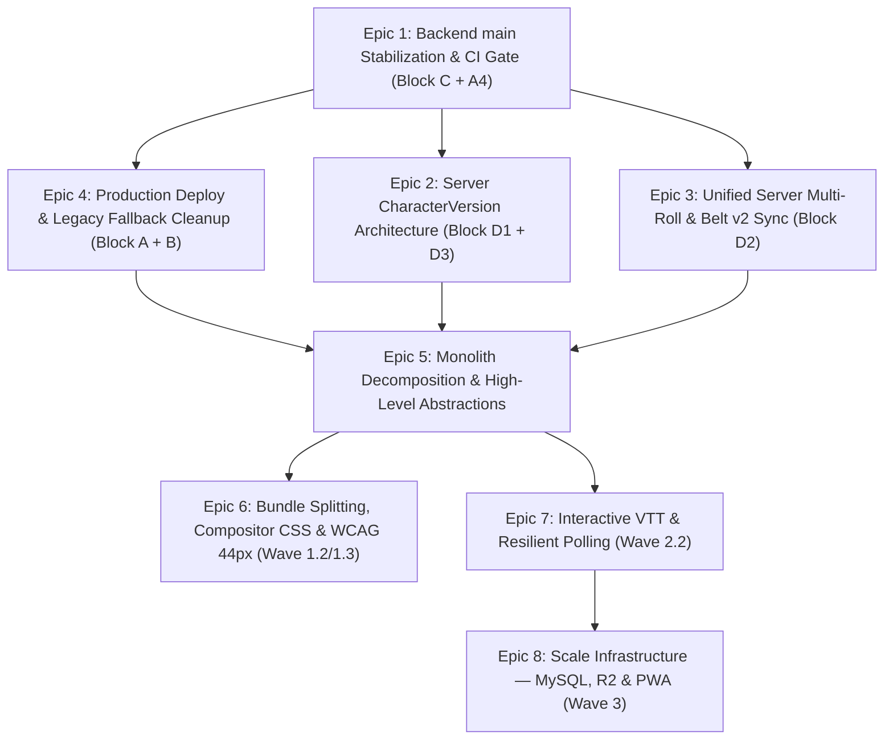

# Master Backlog Grooming, Caveat Analysis & Deterministic Cascade Map

> **Version Baseline**: `v1.0.56` (`507d8b3` on `main`, 2026-11-11)
> **Companion Specifications**: [`ROADMAP.md`](../ROADMAP.md) · [`TECH_DEBT.md`](../TECH_DEBT.md) · [`SYSTEM_MAP.md`](../SYSTEM_MAP.md) · [`ADR.md`](../ADR.md) · [`docs/sync-spec.md`](sync-spec.md) · [`docs/sync-ledger.md`](sync-ledger.md) · [`docs/sync-contracts.md`](sync-contracts.md) · [`docs/character-versions.md`](character-versions.md) · [`SPEC_BELT_HIVE_STATS_HANDOFF.md`](../SPEC_BELT_HIVE_STATS_HANDOFF.md)

---

## 1. Executive Progress Reconciliation (`v1.0.21` → `v1.0.56`)

Between `2026-10-26` and `2026-11-11` (`329+` commits), major portions of [`ROADMAP.md`](../ROADMAP.md) and [`PLANO-MESA-E-METRICAS.md`](../PLANO-MESA-E-METRICAS.md) shipped to `main`, while several new architectural tracks (Multi-Character Party Holster, NPC World Lore Auto-Sync, World Map Hierarchical Regions & External Image Proxy, Character Sheet Hero/Spells Consolidation, Character Versions per Campaign, Belt v2 Paired Multi-Rolls) were introduced.

To eliminate ambiguity between older planning documents and the live repository state at `507d8b3`, every feature across the stack is classified into four deterministic tiers:

| Tier | State | Summary of Features |
| :--- | :--- | :--- |
| **Tier 1: Live End-to-End** | Shipped in both Frontend (`v1.0.56`) & Production Backend (`5655785`) | Character Creator (SRD 5.2.1, 2024 rules), Progression Engine (Lv 1–20), Inventory/Shop/Rest/Exhaustion, Combat Tracker core, World Wiki & Graph, Adventure Library, PDF Sheet Export, TV Screen v1, Dice Log & Rig v1. |
| **Tier 2: Code-Complete on `main` (Pending Backend Deploy)** | Shipped in `main` (`507d8b3`) across both frontend and `backend/`; waiting on Block C test stabilization + Block A PythonAnywhere deploy | **26 new backend routes**: Unified Stage (`POST /campaigns/:id/stage`, `/stage/scene`), Pulse ETag (`GET /campaigns/:id/pulse`), Party Tactical Insights (`GET /campaigns/:id/party-insights`, `/history`), Combat Undo (`POST /combat/campaign/:id/undo`, `/prev-turn`, `/save-preview`, stripped URL assets), Table Rolls (`POST /characters/:pk/table-roll`), Multi-character party seats (`seat: active \| bench \| npc \| left`), World NPC auto-sync (`_sync_char_to_world_npc`), World external URL ingestion & image proxy (`/api/world/fetch-url`, `/api/world/image-proxy`), Prepared Dice per-die queues & jump-queue (`⚡`). |
| **Tier 3: Shipped in Frontend on Transitional Client Storage** | Live in frontend (`v1.0.37`–`v1.0.54`), backed by `localStorage` or `Character.data` JSON shim; requires Block D backend models/endpoints | **Character Versions per Campaign** (`frontend/src/sheet/versions.js` using `Character.data.versions` checkout store; needs `CharacterVersion` model `D1.1`–`D1.14`), **Belt v2 Hive Stats & Paired Multiattack Rolls** (`BeltMultiRoll.jsx`, `fh-belt:<id>` in `localStorage`; needs `D2.1`–`D2.5`), **4-Mode Multi-Roll** (`MultiRoll.jsx`, `fh-multiroll4:<id>` in `localStorage`; needs server `table-roll` composite payload + `DiceRig` consumption `D2.1`–`D2.5`). |
| **Tier 4: Unbuilt Roadmap Backlog** | Specified in `ROADMAP.md` / `TECH_DEBT.md`; not yet implemented in `main` | Monolithic file decomposition (`Sheet.jsx`, `SheetTabs.jsx`, `ficha.css`, `views_combat.py`), Vite `manualChunks` bundle splitting & dynamic/static import cleanup, CSS compositor jank removal, WCAG 44px touch targets, Interactive VTT (Fog of War canvas brush, Player self-token drag, Map Pings, Diegetic Soundscapes), Resilient Polling exponential backoff, and Wave 3 Infrastructure (MySQL pooling, Cloudflare R2 media, PWA Service Worker). |

---

## 2. Exhaustive Caveat & Gap Analysis (In-Between Implementation Realities)

### Caveat 2.1 — Multi-Character / Multi-Campaign Membership Drift (`ADR-0030`, `ADR-0031` vs Legacy Tests)
- **What Shipped**: On `2026-11-09` (`b5ef5eb`, `a7c66eb`), `Membership` dropped `unique_together = [('campaign', 'user')]` in favor of `unique_together = [('campaign', 'character')]` (`0014_membership_multi_char_and_seat.py`) and added `seat` (`active`, `bench`, `npc`, `left`) so a player or DM can link $N$ characters to the same campaign without consuming active party seats when parked on `bench` or `npc`.
- **The Caveats & Gaps**:
  1. **Uncommitted Index Migration (`C1`)**: `backend/api/models.py` updated `Membership.Meta.indexes` after `0014` was generated, leaving `manage.py makemigrations --check` failing until `0015` is generated.
  2. **Legacy Single-Campaign Test Assertions (`C2`–`C5`)**: `backend/api/tests/test_campaign_link.py` still asserts `OneCampaignAtATimeTests` (409 conflict when linking a character without `confirmSwitch`), and `CampaignSerializer.get_myMembership` returns a single membership object while `myMemberships` returns the array. When a user owns multiple characters in the same campaign, `get_myMembership` must deterministically prioritize `active` > `bench` > `npc` > `left` and expose `seat` on both `myMembership` and `myMemberships[]`.
  3. **Base `Character.campaign_id` Single-Pointer Bottleneck**: Because `Character.campaign` is a single ForeignKey on `Character`, a character can currently have `Membership` rows in $M$ campaigns (`seat='left'` in $M-1$ campaigns), but only **one** campaign can be pointed to by `Character.campaign_id` at a time. Full simultaneous active play across multiple tables requires Epic 2 (`CharacterVersion` per `(character, campaign)`).

### Caveat 2.2 — Transitional `Character.data.versions` Checkout Store (`v1.0.54` vs Server `CharacterVersion`)
- **What Shipped**: `frontend/src/sheet/versions.js` and `VersionsModal.jsx` store per-campaign snapshots inside `character.data.versions[key]` and copy the selected snapshot into top-level `character.data` on checkout (`switchActiveVersion`).
- **The Caveats & Gaps**:
  1. **Cross-Table Overwrite Risk**: Because `PUT /api/characters/:id` writes the entire `Character.data` blob, switching active versions in Browser Tab A while a DM edits the character in Campaign B can overwrite `data.versions` unless version state lives in dedicated `CharacterVersion` rows (`D1.1`).
  2. **DM Visibility of Parked (`left`) Versions**: When a player switches their character to Campaign B, Campaign A's snapshot is tucked into `Character.data.versions["camp:<A>"]` and `Character.campaign_id` points to B. Campaign A's DM can no longer inspect Campaign A's historical sheet via standard campaign roster serialization until `Membership.version` FK (`D1.2`) links each campaign membership directly to its `CharacterVersion` row.
  3. **Server-Side Read-Only Enforcement (`D1.9`)**: The UI locks `left` and `archived` versions to read-only, but `PUT /api/characters/:id` and `PATCH /api/characters/:id/state` do not yet enforce HTTP `423 Locked` (`version_read_only`) on the backend.
  4. **Avatar Duplication & `413 Payload Too Large` (`D3.1`–`D3.2`)**: Storing $N$ versions inside `Character.data.versions` risks duplicating base64 portraits ($1\text{–}2\text{ MB}$ each) until `_avatarSame` deduplication and `/api/characters/:id/avatar` binary serving are enforced on `CharacterVersion`.

### Caveat 2.3 — Client-Only Multi-Roll & Belt v2 Paired Rolls (`v1.0.37`–`v1.0.51` vs Server Table-Roll)
- **What Shipped**: `BeltMultiRoll.jsx` (paired Ability + Skill/Save/Attack rolls with crit auto-reroll) and `MultiRoll.jsx` (4-mode multi-roll: `same`, `paired`, `pool`, `sequence`) compute rolls via `window.crypto.getRandomValues` in the browser.
- **The Caveats & Gaps**:
  1. **Invisible on TV & Party Feed**: Neither `BeltMultiRoll.jsx` nor `MultiRoll.jsx` calls `POST /api/characters/:pk/table-roll`, so multiattack turns and paired checks never broadcast to `Campaign.data.rollQueue`, `DiceLog`, or `DiaryEntry`.
  2. **Bypasses Prepared Dice (`DiceRig`)**: If a DM queues prepared dice in `AdvancedDice.jsx` (`POST /api/campaigns/:id/dice-rig`), a player rolling via `MultiRoll` or `BeltMultiRoll` rolls local RNG instead of consuming the rigged queue on the server (`D2.3`).
  3. **Device-Bound Loadouts (`localStorage`)**: Belt v2 slot bindings (`fh-belt:<charId>`) and Multi-Roll presets (`fh-multiroll4:<charId>`) live only in `localStorage`. Moving from PC to phone resets the player's belt hexes and loadout wedges (`I`/`II`) to defaults (`D2.4`).

### Caveat 2.4 — World Lore External Image Proxy, High-Res Preservation & Map Rect Aspect Lock
- **What Shipped**: Commit `fe5695b`, `0e28b59`, and `0215362` added `/api/world/fetch-url`, `/api/world/image-proxy`, `resolveDirectImageUrl()` (normalizing Wikia `/revision/latest`, Reddit `/media?url=`, Imgur page URLs), `maxDim = 0` lossless image preservation on world maps, `containedEntryIds` ("Contains" grouping), and `WorldMap.jsx` child region rectangles (`rects[]`) with aspect-ratio auto-fit (`fitRectToAspect`).
- **The Caveats & Gaps**:
  1. **Async Image Natural Dimensions on External Links**: When a user links an external map URL (rather than uploading a base64 file) on a child `Place`, `childAspect` is only known once the child image's natural `width / height` loads or is stored in `entry.data.imageAspect`. If the user draws a parent map `Rect` before the child place's image has ever been rendered in the session, `WorldMap.jsx` should lazily probe `new Image()` on the child's `imageUrl` (with proxy fallback) and persist `imageAspect` into `entry.data.imageAspect` so `Auto-Fit Ratio` always has deterministic dimensions.
  2. **NPC World Sync Idempotency (`_sync_char_to_world_npc`)**: When a character's seat is toggled to `npc` (`ADR-0031`), `backend/api/views_world.py::_sync_char_to_world_npc` creates/updates a `WorldEntry(category='npc')` keyed by `data.linkedCharacterId`. Once Epic 2 (`CharacterVersion`) lands, `_sync_char_to_world_npc` must read from `Membership.version.data` (the campaign-specific version) rather than `Character.data`.

### Caveat 2.5 — Monolithic Files & Cross-Layer Coupling
A line-count audit at `v1.0.56` (`507d8b3`) reveals 8 files exceeding healthy modularity thresholds:

| File | Current Lines | Primary Coupling / Debt Issue | Target Max Lines |
| :--- | ---: | :--- | ---: |
| [`frontend/src/sheet/ficha.css`](../frontend/src/sheet/ficha.css) | **6,549** | Single monolithic stylesheet mixing hero banner, belt v2 hex geometry, skills, spells, inventory, and modals; 250+ hardcoded hex values. | `< 1,000` per domain CSS module |
| [`frontend/components/Sheet.jsx`](../frontend/components/Sheet.jsx) | **4,093** | Bundles `SheetHero`, `BeltAbilities` (Belt v2 + drag-to-bind), `SheetSkills`, `SheetFeatures`, `SheetNotes`, `SheetNpcs`, `ProgressionPanel`, `WildShapeBar`, and unused dead component `BeltPbSlot`. | `< 500` (orchestrator shell) |
| [`backend/api/views_combat.py`](../backend/api/views_combat.py) | **2,714** | Mixes DRF HTTP views with encounter setup, monster statblock resolution, snapshot undo stack, turn CAS locking, and PC HP/condition write-back. | `< 600` per view/service module |
| [`frontend/styles.css`](../frontend/styles.css) | **2,601** | Legacy global CSS mixing root tokens, creator layout, catalog cards, and modal chrome; uses layout-triggering transitions (`width`, `height`, `margin`). | `< 800` per domain CSS module |
| [`frontend/components/SheetTabs.jsx`](../frontend/components/SheetTabs.jsx) | **1,785** | Bundles `UnifiedSpellsHUD`, `SlotMatrix`, `SpellRow`, `SheetSpells`, `SheetInventory`, `SheetStory`, `SheetTools`, and `SpeciesTraits`. | `< 450` per tab module |
| [`frontend/src/campaigns/url-monster-importer.js`](../frontend/src/campaigns/url-monster-importer.js) | **1,742** | Combines HTML scraping, bilingual regex parsing, CR estimation, and statblock normalization in one file. | `< 500` per parser stage |
| [`backend/api/world_rules.py`](../backend/api/world_rules.py) | **1,518** | Mixes world consistency linting, graph relationship rules, and NPC extraction helpers. | `< 550` per rule module |
| [`frontend/src/prep/NextSession.jsx`](../frontend/src/prep/NextSession.jsx) | **1,434** | Combines session prep editor, scene list, checklist state, and live-table launch wiring. | `< 500` per sub-view |

---

## 3. Exhaustive Groomed Backlog & Deterministic Cascade Map

Every remaining work item is broken down below into atomic, deterministic tasks with explicit **Preconditions**, **Implementation Steps**, **Cascade Impact Map** (exact files, functions, classes, and tests affected), and **Verification Criteria**.

---

### EPIC 1 — Backend `main` Stabilization, Migration `0015` & CI Release Gate (`sync-spec` Block C + A4)
**Goal**: Bring `python manage.py test` on `main` from `13 failures, 2 errors` to `1,005/1,005 passing (0 failures, 0 errors)` and enforce automated test gating in CI before packaging `forja-release.zip`.

#### Task 1.1 (`C1`): Generate & Commit Migration `0015_membership_index_sync.py`
- **Problem**: `Membership.Meta.indexes` in [`backend/api/models.py`](../backend/api/models.py) diverged from [`backend/api/migrations/0014_membership_multi_char_and_seat.py`](../backend/api/migrations/0014_membership_multi_char_and_seat.py), causing `makemigrations --check` to fail in `MigrationHealthTests`.
- **Action**: Run `python manage.py makemigrations` to create `0015` (removes `api_members_user_id_idx`, renames `api_members_camp_char_idx`).
- **Cascade Map**:
  - `backend/api/migrations/0015_*.py` (new file)
  - `backend/api/tests/test_api.py::MigrationHealthTests.test_no_missing_migrations`

#### Task 1.2 (`C2`, `C3`, `C4`, `C5`): Reconcile Multi-Character & Multi-Campaign Membership Semantics (`ADR-0030` / `ADR-0031`)
- **Problem**:
  - `views_campaigns.py::campaign_characters`, `campaign_join`, and `character_campaign` were updated on `09/11` to allow multiple characters per user in a campaign (`seat: active | bench | npc | left`) and to park previous campaign memberships as `seat='left'` on switch.
  - However, 10 tests in [`backend/api/tests/test_campaign_link.py`](../backend/api/tests/test_campaign_link.py) still expect legacy single-campaign 409 errors or fail because `myMembership` / `seat` serialization and DM self-attach rules are inconsistent.
- **Action**:
  1. **Cross-Campaign Switch Confirmation (`C2`/`C3`)**: When a character is currently `seat='active'` in an **open** campaign $A$ (`is_open=True`, `archived=False`) and a request links that same character to campaign $B$ without `confirmSwitch=True`, return `409 Conflict` (`{"error": "already_in_campaign", "currentCampaign": ...}`). When `confirmSwitch=True` (or when Campaign $A$ is closed/archived), transition Campaign $A$'s membership to `seat='left'` (preserving the membership row and history) and activate Campaign $B$'s membership (`seat='active'`, `Character.campaign = B`).
  2. **DM Self-Attach & Roster Rules (`C4`)**:
     - On `POST /api/campaigns/:id/join` (player invite-code join), retain the guard preventing the campaign's DM from joining their own table as a player via invite code (`400 Bad Request`).
     - On `POST /api/campaigns/:id/characters` and `POST /api/characters/:id/campaign`, allow the DM to attach their own characters (`seat='npc'`, `'bench'`, or `'active'`) so the DM can populate party NPCs and test sheets, while keeping `role='dm'` on any DM membership.
  3. **Deterministic `myMembership` & `myMemberships` Serialization (`C5`)**:
     - In [`backend/api/serializers.py`](../backend/api/serializers.py) (`CampaignSerializer.get_myMembership` and `get_myMemberships`), serialize `seat` on every membership dict (`id`, `role`, `seat`, `characterId`, `characterName`, `sponsored`).
     - Sort `myMemberships` deterministically by seat priority (`active` $\to$ `bench` $\to$ `npc` $\to$ `left`) then `id`, and return `myMemberships[0]` as `myMembership`.
     - Ensure `views_campaigns.py::_unlink_character_from_campaign` only clears `Character.campaign = None` if `Character.campaign_id == campaign.id` and no other `active`/`bench`/`npc` membership in that campaign holds it.
- **Cascade Map**:
  - [`backend/api/views_campaigns.py`](../backend/api/views_campaigns.py): `_attach_character_to_campaign`, `_unlink_character_from_campaign`, `campaign_join`, `campaign_characters`, `character_campaign`, `campaign_set_character_seat`.
  - [`backend/api/serializers.py`](../backend/api/serializers.py): `CampaignSerializer.get_myMembership`, `CampaignSerializer.get_myMemberships`, `MembershipSerializer`.
  - [`backend/api/tests/test_campaign_link.py`](../backend/api/tests/test_campaign_link.py): `OneCampaignAtATimeTests`, `MultiCharPerPlayerTests`.

#### Task 1.3 (`C6`): Wire All Domain Mutation Sources into Pulse ETag (`views_pulse.py`)
- **Problem**: `test_world_entry_edit_bumps_rev` and `test_combat_encounter_change_bumps_rev` fail in [`backend/api/tests/test_pulse.py`](../backend/api/tests/test_pulse.py) because `_compute_pulse_rev` in [`backend/api/views_pulse.py`](../backend/api/views_pulse.py) does not include the latest timestamps/revisions from `WorldEntry`, `CombatEncounter`, and `Character` rows linked to the campaign.
- **Action**: Update `_compute_pulse_rev(campaign, user)` in [`backend/api/views_pulse.py`](../backend/api/views_pulse.py) to aggregate:
  - `campaign.updated_at` + stage/rollQueue revision markers inside `campaign.data`
  - `Max(WorldEntry.updated_at)` + `Count(WorldEntry.id)` for `campaign`
  - `Max(CombatEncounter.updated_at)` + active encounter `round`/`turn_index`/action count
  - `Max(Character.updated_at)` across campaign members
  - `Max(DiceLog.id)` and `Max(PendingRoll.updated_at)` / `Max(ApprovalRequest.updated_at)`
- **Cascade Map**:
  - [`backend/api/views_pulse.py`](../backend/api/views_pulse.py): `_compute_pulse_rev`, `campaign_pulse`.
  - [`backend/api/tests/test_pulse.py`](../backend/api/tests/test_pulse.py): `PulseEndpointTests`.

#### Task 1.4 (`C7`, `C8`): Enforce `dm_settings` Write Guard & Player Secret Redaction
- **Problem**:
  - `C7`: `test_player_cannot_set_dm_settings` in [`backend/api/tests/test_modes.py`](../backend/api/tests/test_modes.py) fails because `PATCH /api/characters/:pk/state` in [`backend/api/views_characters.py`](../backend/api/views_characters.py) allows a non-DM character owner to patch `dm_settings` while the character is linked to a campaign.
  - `C8`: `test_secrets_hidden_from_non_dm` in [`backend/api/tests/test_api.py`](../backend/api/tests/test_api.py) fails because `CampaignSerializer.to_representation` leaks `data.secrets` (or secret notes) when serializing campaign details for non-DM members.
- **Action**:
  - In [`backend/api/views_characters.py`](../backend/api/views_characters.py) (`character_state_patch` and `character_detail` PUT), reject mutations to `dm_settings` with `403 Forbidden` when the character is linked to a campaign and `request.user_obj.id != campaign.dm_id`.
  - In [`backend/api/serializers.py`](../backend/api/serializers.py) (`CampaignSerializer.to_representation`), strip `secrets` / `dmNotes` from `data` whenever `request.user_obj.id != instance.dm_id`.
- **Cascade Map**:
  - [`backend/api/views_characters.py`](../backend/api/views_characters.py): `character_state_patch`, `character_detail`.
  - [`backend/api/serializers.py`](../backend/api/serializers.py): `CampaignSerializer.to_representation`.
  - [`backend/api/tests/test_modes.py`](../backend/api/tests/test_modes.py), [`backend/api/tests/test_state_patch.py`](../backend/api/tests/test_state_patch.py), [`backend/api/tests/test_api.py`](../backend/api/tests/test_api.py).

#### Task 1.5 (`A4`, `C9`): Harden `self_update.py` Version Tracking & Add CI Test Gate
- **Problem**:
  - `A4`: [`scripts/self_update.py`](../scripts/self_update.py) falls back to GitHub's archive zip when `forja-release.zip` is missing, leaving `VERSION.json` unwritten (`unknown`).
  - `C9`: [`.github/workflows/backend-release.yml`](../.github/workflows/backend-release.yml) packages `forja-release.zip` without running `python manage.py test`.
- **Action**:
  - Update [`scripts/self_update.py`](../scripts/self_update.py) (`deploy()`) to always write `VERSION.json` from the resolved commit SHA (`target_sha`) if the extracted archive did not contain one.
  - Add a mandatory `Run backend test suite` step (`python manage.py makemigrations --check && python manage.py test`) to [`.github/workflows/backend-release.yml`](../.github/workflows/backend-release.yml) prior to `Build release bundle`.
- **Cascade Map**:
  - [`scripts/self_update.py`](../scripts/self_update.py)
  - [`.github/workflows/backend-release.yml`](../.github/workflows/backend-release.yml)

---

### EPIC 2 — Server-Side Character Versions Architecture (`sync-spec` Block D1 & D3, `ADR-0034`)
**Goal**: Replace the transitional `Character.data.versions` client checkout store (`v1.0.54`) with first-class `CharacterVersion` rows on the server so a character can be simultaneously active across $N$ campaigns, DMs can inspect parked (`left`) versions, and `left`/`archived` versions are locked server-side (`423 Locked`).

#### Task 2.1 (`D1.1`, `D1.2`): Create `CharacterVersion` Model & `Membership.version` ForeignKey
- **Schema**:
  - `CharacterVersion` in [`backend/api/models.py`](../backend/api/models.py):
    - `character = ForeignKey(Character, related_name='versions', on_delete=CASCADE)`
    - `campaign = ForeignKey(Campaign, null=True, blank=True, related_name='character_versions', on_delete=SET_NULL)`
    - `kind = CharField(choices=[('base', 'Base'), ('campaign', 'Campaign')])`
    - `status = CharField(choices=[('active', 'Active'), ('left', 'Left'), ('archived', 'Archived')], default='active')`
    - `label = CharField(max_length=140)`
    - `campaign_name = CharField(max_length=140, blank=True, default='')`
    - `forked_from = CharField(max_length=64, blank=True, default='base')`
    - `data = JSONField(default=dict)`
    - `avatar_same_as_base = BooleanField(default=True)`
    - `created_at`, `updated_at`, `archived_at`
    - Constraints: Unique `(character, campaign)` where `campaign__isnull=False`; Unique `(character, kind)` where `kind='base'`.
  - Add `Membership.version = ForeignKey(CharacterVersion, null=True, blank=True, on_delete=SET_NULL, related_name='memberships')`.
- **Cascade Map**:
  - [`backend/api/models.py`](../backend/api/models.py): `CharacterVersion`, `Membership`.
  - `backend/api/migrations/0016_character_version.py`.

#### Task 2.2 (`D1.3`–`D1.10`, `D3.1`–`D3.2`): Implement `views_versions.py`, Read-Only Guards & Avatar Deduplication
- **Endpoints to Create in `backend/api/views_versions.py` & Wire in `backend/api/urls.py`**:
  1. `GET /api/characters/:pk/versions` — list metadata (`id`, `key`, `kind`, `campaignId`, `campaignName`, `status`, `readOnly`, `level`, `classId`, `updatedAt`, `forkedFrom`).
  2. `GET /api/characters/:pk/versions/:vkey` — full `data` payload for `base` or `camp:<campaignId>` (accessible by character owner or the DM of `campaignId`).
  3. `PUT /api/characters/:pk/versions/:vkey` & `PATCH /api/characters/:pk/versions/:vkey/state` — update version sheet; returns `423 Locked` (`{"error": "version_read_only", "status": version.status}`) when `status in ('left', 'archived')`.
  4. `POST /api/characters/:pk/versions` — fork a new campaign version from `base` or an existing `camp:<id>` (`forkCharacterForCampaign` parity).
  5. `POST /api/characters/:pk/versions/:vkey/sync-from-base` — copy cosmetic fields (`name`, `appearance`, `backstory`, `personality`, `ideals`, `bonds`, `flaws`, `avatar`) from `base` into an `active` campaign version while preserving mechanical state (`level`, `xp`, `hp`, `inventory`, `spells`, `feats`).
  6. `GET /api/characters/:pk/versions/:vkey/avatar` — serve binary avatar with ETag (`D3.1`); if `avatar_same_as_base=True`, delegate to base character's avatar (`D3.2`).
- **Lifecycle Hooks**:
  - When a character leaves a campaign (`DELETE /api/campaigns/:id/characters/:char_id` or `seat='left'`), transition that campaign's `CharacterVersion.status` to `'left'` (do not delete).
  - When a campaign closes or is deleted (`D1.10`), transition all associated `CharacterVersion` rows to `status='archived'`, `archived_at=now()`.
- **Cascade Map**:
  - `backend/api/views_versions.py` (new module, `<450` lines)
  - [`backend/api/urls.py`](../backend/api/urls.py)
  - [`backend/api/views_campaigns.py`](../backend/api/views_campaigns.py): `_attach_character_to_campaign`, `_unlink_character_from_campaign`, `campaign_detail` (DELETE/close), `campaign_archive`.

#### Task 2.3 (`D1.11`): Re-Route All 10 Gameplay Consumers to Read/Write `Membership.version.data`
- **Problem**: Currently, 10 backend gameplay modules read/write `character.data` directly. When a character is in Campaign $X$, those endpoints must read/write the `CharacterVersion` linked to Campaign $X$'s `Membership` (falling back to `character.data` only when unlinked or on legacy rows).
- **Action**: Introduce a single helper `resolve_sheet_target(character, campaign=None)` in `backend/api/services/version_resolver.py` that returns a unified accessor `(target_obj, data_dict, save_fn)` backed by `CharacterVersion` when in a campaign or `Character` when solo.
- **Cascade Map (All 10 Consumers)**:
  1. [`backend/api/views_combat.py`](../backend/api/views_combat.py): `_pc_combatant_from_character`, `_sync_pc_sheet_hp`, `_apply_action_to_target`.
  2. [`backend/api/views_dice.py`](../backend/api/views_dice.py): `sheet_roll`, `campaign_roll`.
  3. [`backend/api/views_checks.py`](../backend/api/views_checks.py): `party_check_roll`, `approval_resolve`.
  4. [`backend/api/views_world.py`](../backend/api/views_world.py): `_sync_char_to_world_npc`.
  5. [`backend/api/views_screen.py`](../backend/api/views_screen.py): `public_campaign_screen`, `public_portrait`.
  6. [`backend/api/views_insights.py`](../backend/api/views_insights.py): `campaign_party_insights`.
  7. [`backend/api/views_characters.py`](../backend/api/views_characters.py): `character_cast`, `character_rest`, `character_use_item`, `character_dm_edit`.
  8. [`backend/api/serializers.py`](../backend/api/serializers.py): `CampaignDetailSerializer` member character summaries.

#### Task 2.4 (`D1.12`–`D1.14`): Data Migration Unpacking `Character.data.versions` & Frontend Cutover
- **Action**:
  - Write migration `0017_unpack_character_versions_data.py` that iterates all `Character` rows, creates a `base` `CharacterVersion` and any `camp:<id>` `CharacterVersion` entries found in `Character.data.get("versions")`, links `Membership.version`, resolves `_avatarSame`, and strips the nested `versions` dict from `Character.data`.
  - Update [`frontend/src/sheet/versions.js`](../frontend/src/sheet/versions.js) and [`frontend/src/sheet/VersionsModal.jsx`](../frontend/src/sheet/VersionsModal.jsx) to call `/api/characters/:id/versions` when the backend supports it while keeping the pure helper transforms for unit tests.

---

### EPIC 3 — Unified Server Dice Pipeline for Multi-Roll & Belt v2 (`sync-spec` Block D2, `ADR-0032`, `ADR-0033`)
**Goal**: Connect `MultiRoll.jsx` (4 modes) and `BeltMultiRoll.jsx` (Belt v2 ability-paired rolls + crit auto-reroll) to the server dice pipeline, TV roll queue, `DiceLog`, `DiaryEntry`, `DiceRig`, and server-persisted character sheet config.

#### Task 3.1 (`D2.1`, `D2.2`, `D2.3`): Upgrade `POST /api/characters/:pk/table-roll` for Composite / Multi-Group Rolls
- **Problem**: [`backend/api/table_rolls.py`](../backend/api/table_rolls.py) (`clean_sheet_roll`) only accepts a single die roll (`d20` or `damage`).
- **Action**:
  1. Extend `clean_sheet_roll` in [`backend/api/table_rolls.py`](../backend/api/table_rolls.py) to accept an optional `multiRoll` payload:
     - `mode`: `'same' | 'paired' | 'pool' | 'sequence' | 'belt-paired'`
     - `groups[]`: array of `{ label, sides, count, modifier, rolls[], kept[], total, crit, fumble, critExtra?: { rolls[], total } }`
     - `grandTotal`, `summary`
  2. **Server-Side `DiceRig` Consumption (`D2.3`)**: When `useServerRng=True` or when a `DiceRig` queue is armed for the player/DM in the active campaign, pop rigged values per die size (`d20`, `d8`, `d6`, etc.) in FIFO order inside `views_dice.py::sheet_roll` before falling back to `secrets.randbelow(sides) + 1`.
  3. **Audit Logging (`D2.2`)**: Record a structured `DiceLog` row (`kind="multi"`, `detail=groups`) and append a concise summary entry to `Campaign.rollQueue` so the TV overlay (`frontend/src/screen/roll-queue.js` / `TVScreen.jsx`) animates the composite roll.
- **Cascade Map**:
  - [`backend/api/table_rolls.py`](../backend/api/table_rolls.py): `clean_sheet_roll`, `append_table_roll`.
  - [`backend/api/views_dice.py`](../backend/api/views_dice.py): `sheet_roll`, `_consume_rigged_die`.
  - [`frontend/src/dice/sheet-roll.js`](../frontend/src/dice/sheet-roll.js): `postTableRoll`, `postMultiTableRoll`.
  - [`frontend/src/dice/MultiRoll.jsx`](../frontend/src/dice/MultiRoll.jsx) & [`frontend/src/dice/BeltMultiRoll.jsx`](../frontend/src/dice/BeltMultiRoll.jsx).
  - [`frontend/src/screen/TVScreen.jsx`](../frontend/src/screen/TVScreen.jsx) & [`frontend/src/screen/roll-queue.js`](../frontend/src/screen/roll-queue.js).

#### Task 3.2 (`D2.4`, `D2.5`): Persist Belt v2 (`beltConfig`) & Multi-Roll Presets (`multiRollConfig`) on the Server
- **Problem**: Belt v2 hex slots, PB wedges, and Loadout I/II (`fh-belt:<id>`) and Multi-Roll presets (`fh-multiroll4:<id>`) are stored only in `localStorage`.
- **Action**:
  - Read initial config from `character.data.beltConfig` (falling back to `localStorage` `fh-belt:<id>` for one-time hydration) and `character.data.multiRollConfig` (falling back to `fh-multiroll4:<id>`).
  - Persist mutations via debounced `PATCH /api/characters/:id/state` (`{ beltConfig, multiRollConfig }`), whitelisting both keys in `ALLOWED_STATE_PATCH_KEYS` in [`backend/api/views_characters.py`](../backend/api/views_characters.py).
- **Cascade Map**:
  - [`frontend/src/sheet/belt-hivemind.js`](../frontend/src/sheet/belt-hivemind.js): `loadBeltState`, `saveBeltState`.
  - [`frontend/src/dice/MultiRoll.jsx`](../frontend/src/dice/MultiRoll.jsx).
  - [`frontend/components/Sheet.jsx`](../frontend/components/Sheet.jsx).
  - [`backend/api/views_characters.py`](../backend/api/views_characters.py): `character_state_patch`.

---

### EPIC 4 — Production Backend Cutover & Legacy Fallback Retirement (`sync-spec` Block A & B)
**Goal**: Deploy the stabilized `main` backend to PythonAnywhere (`https://ivansouza.pythonanywhere.com`) and delete the 35 temporary `"servidor antigo"` fallback branches across 22 frontend files.

#### Task 4.1 (`A1`–`A6`): Execute & Verify Production Backend Self-Update
- **Action**:
  1. Ensure `FORJA_UPDATE_KEY` (GitHub repository secret) and `FORJA_UPDATE_KEY_SHA256` (PythonAnywhere `.env`) match (`A1`).
  2. Trigger `.github/workflows/backend-release.yml` on `main` (which runs the full Django test suite from Task 1.5, builds `forja-release.zip`, and calls `POST /api/admin/self-update`).
  3. Verify `GET https://ivansouza.pythonanywhere.com/api/health` reports `commit == HEAD`, `db == True`, and `migrationsPending == 0`.

#### Task 4.2 (`B1`–`B5`): Remove 35 Legacy `"servidor antigo"` Fallback Branches Across 22 Frontend Files
- **Precondition**: Task 4.1 verified healthy for $\ge 7$ days in production.
- **Cascade Map (Exact 22 Files to Clean)**:
  1. [`frontend/src/api/old-server.js`](../frontend/src/api/old-server.js) & [`frontend/src/api/old-server.test.js`](../frontend/src/api/old-server.test.js) (delete shim module & contract test).
  2. [`frontend/src/stage/stage-api.js`](../frontend/src/stage/stage-api.js), [`frontend/src/stage/useStage.js`](../frontend/src/stage/useStage.js), [`frontend/src/stage/ScreenWindow.jsx`](../frontend/src/stage/ScreenWindow.jsx), [`frontend/src/stage/LiveScreenSheet.jsx`](../frontend/src/stage/LiveScreenSheet.jsx), [`frontend/src/stage/ShowSheet.jsx`](../frontend/src/stage/ShowSheet.jsx), [`frontend/src/stage/MiniPlayer.jsx`](../frontend/src/stage/MiniPlayer.jsx).
  3. [`frontend/src/play/table-store.js`](../frontend/src/play/table-store.js), [`frontend/src/play/NowPanel.jsx`](../frontend/src/play/NowPanel.jsx).
  4. [`frontend/src/prep/PrepTab.jsx`](../frontend/src/prep/PrepTab.jsx), [`frontend/src/prep/SceneSheet.jsx`](../frontend/src/prep/SceneSheet.jsx), [`frontend/src/prep/NextSession.jsx`](../frontend/src/prep/NextSession.jsx).
  5. [`frontend/src/group/insights-api.js`](../frontend/src/group/insights-api.js), [`frontend/src/group/PartyInsights.jsx`](../frontend/src/group/PartyInsights.jsx).
  6. [`frontend/src/campaigns/CampaignDetail.jsx`](../frontend/src/campaigns/CampaignDetail.jsx), [`frontend/src/campaigns/CombatTab.jsx`](../frontend/src/campaigns/CombatTab.jsx), [`frontend/src/campaigns/CharacterLinkModal.jsx`](../frontend/src/campaigns/CharacterLinkModal.jsx), [`frontend/src/campaigns/ChecksBar.jsx`](../frontend/src/campaigns/ChecksBar.jsx), [`frontend/src/campaigns/ApprovalsBar.jsx`](../frontend/src/campaigns/ApprovalsBar.jsx).
  7. [`frontend/src/world/WorldTab.jsx`](../frontend/src/world/WorldTab.jsx), [`frontend/src/world/EntryEditor.jsx`](../frontend/src/world/EntryEditor.jsx).
  8. [`frontend/src/shell/AdvancedDice.jsx`](../frontend/src/shell/AdvancedDice.jsx).

---

### EPIC 5 — Monolith Decomposition & High-Level Component/Service Abstractions (`TECH_DEBT` §8, `ADR-0036`)
**Goal**: Eliminate monolithic files (`>1,500` lines) by extracting cohesive, single-responsibility modules with clean public interfaces, zero circular dependencies, and preserved backward-compatible re-exports during transition.

#### Task 5.1: Decompose `frontend/components/Sheet.jsx` (4,093 lines $\to$ `< 500` lines)
- **Dead Code Removal**: Delete unused `BeltPbSlot` component and orphaned helper functions in [`frontend/components/Sheet.jsx`](../frontend/components/Sheet.jsx).
- **Modular Extraction Map**:
  1. `frontend/src/sheet/hero/SheetHero.jsx` (`~480` lines): `SheetHero`, `LevelUpButton`, `CampaignSealButton`, `HeroInspirationSeal`, `RestButtons`, portrait lightbox & discrete `Cheat -> Edit -> Export` toolbar.
  2. `frontend/src/sheet/belt/BeltHive.jsx` (`~520` lines): `BeltAbilities`, `BeltLoadoutWedge`, `BeltPbWedge`, `useBeltDragAndDrop`, `BeltSlotConfigPopover`.
  3. `frontend/src/sheet/tabs/SheetSkillsSection.jsx` (`~490` lines): `SheetSkills`, 4 collapsible action groups (`Search`, `Study`, `Influence`, `Hide`) + `Use Tool`, inline proficiency diamonds, passive score pills.
  4. `frontend/src/sheet/tabs/SheetFeaturesSection.jsx` (`~510` lines): `SheetFeatures`, collapsible feature cards, resource pips, action-economy filter chips (`Action`, `Bonus`, `Reaction`, `Passive`).
  5. `frontend/src/sheet/tabs/SheetCompanionsAndNotes.jsx` (`~420` lines): `SheetNotes`, `SheetNpcs`, `WildShapeBar`, `FamiliarCard`.
  6. [`frontend/components/Sheet.jsx`](../frontend/components/Sheet.jsx) (`~450` lines): Top-level sheet state orchestrator, version banner integration, and tab router.

#### Task 5.2: Decompose `frontend/components/SheetTabs.jsx` (1,785 lines $\to$ `< 400` lines)
- **Modular Extraction Map**:
  1. `frontend/src/sheet/spells/UnifiedSpellsHUD.jsx` (`~280` lines): Consolidated `(Abil) Spell Save DC`, `(Abil) Spell Attack Bonus`, concentration banner, and prepared counter.
  2. `frontend/src/sheet/spells/SlotMatrix.jsx` (`~240` lines): Interactive diamond slot matrix separating Long Rest Spellcasting vs Short Rest Pact Magic.
  3. `frontend/src/sheet/spells/SpellRow.jsx` (`~360` lines): Folded spell row with casting time, school, range, upcast picker, and SRD 5.2.1 description drawer (`spell-text.js`).
  4. `frontend/src/sheet/inventory/SheetInventoryTab.jsx` (`~450` lines): Coin pouch, encumbrance bar, attunement slots, equipment list, and shop modal trigger.
  5. `frontend/src/sheet/story/SheetStoryTab.jsx` (`~320` lines): Personality, backstory, languages/proficiencies editor, and `SpeciesTraits`.
  6. [`frontend/components/SheetTabs.jsx`](../frontend/components/SheetTabs.jsx): Barrel re-export + shared tab primitives.

#### Task 5.3: Split `frontend/src/sheet/ficha.css` (6,549 lines) into Domain Stylesheets & Tokenize Colors
- **Modular Extraction Map**:
  1. `frontend/src/sheet/css/sheet-tokens.css` — semantic custom properties (`--sheet-gold`, `--sheet-surface`, `--sheet-border`, `--belt-hex-w`, etc.).
  2. `frontend/src/sheet/css/sheet-hero.css` — hero banner, portrait frame, seals, rest bar, discrete top-right icon actions.
  3. `frontend/src/sheet/css/sheet-belt.css` — 3–4–3 honeycomb hive geometry, `.fh-belt-pb-wedge`, `.fh-belt-loadout-wedge`, drag-and-drop states.
  4. `frontend/src/sheet/css/sheet-skills-features.css` — action groups, skill pills, diamond toggles, feature cards.
  5. `frontend/src/sheet/css/sheet-spells.css` — `UnifiedSpellsHUD`, `SlotMatrix` diamonds, `SpellRow` cards.
  6. `frontend/src/sheet/css/sheet-inventory-modals.css` — inventory table, shop, level-up, and version modals.
  7. [`frontend/src/sheet/ficha.css`](../frontend/src/sheet/ficha.css) — clean `@import` manifest (`< 50` lines).

#### Task 5.4: Decompose `backend/api/views_combat.py` (2,714 lines) & `backend/api/world_rules.py` (1,518 lines)
- **Modular Extraction Map**:
  1. `backend/api/services/combat_setup.py` (`~480` lines): `_pc_combatant_from_character`, monster statblock hydration, initiative sorting, single-call encounter bootstrap.
  2. `backend/api/services/combat_Undo.py` (`~320` lines): Bounded 20-snapshot undo ring buffer (`_take_undo_snapshot`, `combat_undo`, `combat_prev_turn`).
  3. `backend/api/services/combat_actions.py` (`~520` lines): `opId` idempotency ring buffer, damage/heal/temp-hp/condition application, concentration saves, PC sheet write-back (`_sync_pc_sheet_hp`).
  4. `backend/api/services/combat_media.py` (`~280` lines): Stripped base64 image extraction & binary/ETag serving for `/map-image`, `/token/:id`, `/portrait/:id`, `/actions/:ref`.
  5. [`backend/api/views_combat.py`](../backend/api/views_combat.py) (`~550` lines): Thin DRF request validation, permission checks, and HTTP response serialization.

---

### EPIC 6 — Bundle Splitting, CSS Compositor Performance & WCAG 2.2 AA Hardening (Wave 1.2 & 1.3)
**Goal**: Drop initial main JS bundle from `1,843 kB` (528 kB gzip) to `< 300 kB` gzip, eliminate layout-thrashing CSS transitions, and achieve 100% WCAG 2.2 AA touch target compliance.

#### Task 6.1: Resolve Static/Dynamic Import Collisions & Configure `manualChunks`
- **Problem**: Vite build emits chunk warnings because [`frontend/src/creator/SpeciesChoices.jsx`](../frontend/src/creator/SpeciesChoices.jsx) and [`frontend/src/stage/LiveScreenSheet.jsx`](../frontend/src/stage/LiveScreenSheet.jsx) are imported both statically and dynamically, and `frontend/data/srd-*.json` is bundled into the main entry chunk.
- **Action**:
  - Unify import style for `SpeciesChoices.jsx` and `LiveScreenSheet.jsx`.
  - Configure `build.rollupOptions.output.manualChunks` in [`frontend/vite.config.js`](../frontend/vite.config.js) to isolate `srd-core`, `srd-spells`, `srd-bestiary`, `vendor-three`, and `vendor-pdf`.
- **Cascade Map**:
  - [`frontend/vite.config.js`](../frontend/vite.config.js)
  - [`frontend/components/Creator.jsx`](../frontend/components/Creator.jsx), [`frontend/src/creator/SpeciesChoices.jsx`](../frontend/src/creator/SpeciesChoices.jsx)
  - [`frontend/src/stage/TableBar.jsx`](../frontend/src/stage/TableBar.jsx), [`frontend/src/stage/LiveScreenSheet.jsx`](../frontend/src/stage/LiveScreenSheet.jsx)

#### Task 6.2: Replace Non-Composited CSS Transitions & Enforce $\ge 44\times 44\text{px}$ Touch Targets
- **Action**:
  - Replace `transition: all` and layout transitions (`width`, `height`, `margin`, `padding`) with GPU-composited `transform: scaleX()` / `opacity` across [`frontend/styles.css`](../frontend/styles.css), [`frontend/src/creator/creator.css`](../frontend/src/creator/creator.css), [`frontend/src/screen/tv-styles.css`](../frontend/src/screen/tv-styles.css), [`frontend/src/shell/shell.css`](../frontend/src/shell/shell.css), and [`frontend/src/shell/mesa.css`](../frontend/src/shell/mesa.css).
  - Increase `.fh-join-code-actions .btn` (`30px` $\to$ `44px` hit area) in [`frontend/src/campaigns/join-table.css`](../frontend/src/campaigns/join-table.css) and `.camp-char-Inspect` (`26px` $\to$ `44px`) in [`frontend/src/app-extra-styles.css`](../frontend/src/app-extra-styles.css).

---

### EPIC 7 — Interactive VTT Completion & Resilient Polling (Wave 2.2)
**Goal**: Complete the remaining 5 interactive table features from [`PLANO-MESA-E-METRICAS.md`](../PLANO-MESA-E-METRICAS.md) Frente B.

#### Task 7.1: Fog of War Interactive Brush (`fog.ops[]`)
- **Action**: Add SVG/Canvas reveal/hide brush (`circle` and `rect` ops) in [`frontend/src/campaigns/CombatGrid.jsx`](../frontend/src/campaigns/CombatGrid.jsx) (DM view: 40% translucent overlay; TV/Player view in [`frontend/src/screen/TVScreen.jsx`](../frontend/src/screen/TVScreen.jsx): 100% opaque `#0d0906` mask). Persist normalized `ops[]` via `PATCH /api/combat/campaign/:id/fog`.

#### Task 7.2: Player Self-Token Dragging (`PATCH /api/combat/campaign/:id/token-move`)
- **Action**: Allow players to drag their own linked character token on [`frontend/src/campaigns/CombatGrid.jsx`](../frontend/src/campaigns/CombatGrid.jsx) when `encounter.settings.playersMoveTokens == True` (and when `moveOnlyOnTurn` is satisfied), enforcing a server-side ownership & turn check in `views_combat.py`.

#### Task 7.3: Map Pings (`POST /api/campaigns/:id/ping`)
- **Action**: Long-press (`350ms`) on the tactical map or world map sends `{ x, y, color, senderName }` to `POST /api/campaigns/:id/ping`, appending an ephemeral ping to Pulse/Stage that renders a 4-second expanding radial ring on all connected screens.

#### Task 7.4: Diegetic Soundscapes (`stage.audio`)
- **Action**: Add a lightweight WebAudio ambient loop controller (`frontend/src/stage/SoundscapeBar.jsx`) driven by `stage.audio` (`trackId`, `playing`, `volume`) with 6 CC0 ambient presets (`tavern`, `dungeon`, `forest`, `storm`, `boss`, `crypt`).

#### Task 7.5: Resilient Polling Exponential Backoff (`frontend/src/api/polling.js`)
- **Action**: Upgrade [`frontend/src/api/polling.js`](../frontend/src/api/polling.js) and [`frontend/src/play/table-store.js`](../frontend/src/play/table-store.js) to back off on network/5xx errors (`2.5s` $\to$ `5s` $\to$ `10s` $\to$ `30s` with $\pm 15\%$ jitter), pause when `document.hidden`, immediately resume on `visibilitychange`, and surface a discrete connection status badge (`Online` / `Reconectando…`) in `TableBar.jsx`.

---

### EPIC 8 — Scale Infrastructure: MySQL Pooling, R2 Object Storage & PWA (Wave 3)
**Goal**: Prepare the deployment topology for high-concurrency tables and zero-DB-bloat media storage.

- **Task 8.1**: Configure `CONN_MAX_AGE = 60` and `OPTIONS.init_command = "SET sql_mode='STRICT_TRANS_TABLES'"` for MySQL in [`backend/forja_backend/settings.py`](../backend/forja_backend/settings.py), plus automated pre-migration database backup in [`scripts/self_update.py`](../scripts/self_update.py).
- **Task 8.2**: Add S3/Cloudflare R2 presigned upload & CDN URL resolution (`backend/api/storage_r2.py`) so world maps, portraits, and scene handouts store lightweight HTTPS CDN URLs instead of base64 blobs in SQLite/MySQL.
- **Task 8.3**: Add a Workbox/Vite PWA Service Worker (`frontend/public/sw.js`) with `CacheFirst` for `/data/srd-*.json`, fonts, and icons, and `NetworkFirst` for `/api/characters/*` so players can view and roll from their sheets during temporary Wi-Fi drops.

---

## 4. Architectural Governance Rules (Preventing Future Tech Debt)

1. **Strict Module Size Budgets**:
   - React UI Components: **max 500 lines** (split sub-views into domain folders under `frontend/src/<domain>/`).
   - Pure JS Domain Engines: **max 500 lines** (100% pure functions, zero DOM/React/fetch imports, 100% unit-tested).
   - CSS Domain Files: **max 800 lines** (no raw hex literals outside `sheet-tokens.css` / `:root`; only `transform` and `opacity` in `transition`).
   - Django View Modules: **max 600 lines** (extract business rules and multi-model transactions into `backend/api/services/<domain>.py`).
2. **Contract-First API Evolution**:
   - Every new or modified backend endpoint must be registered in [`docs/sync-contracts.md`](sync-contracts.md) and [`API.md`](../API.md) with request schema, response schema, error status codes, and pulse `rev` impact before merging.
3. **Zero Silent State Bleed**:
   - Campaign-scoped character state must resolve through `resolve_sheet_target(character, campaign)` (`CharacterVersion`), never by mutating global character JSON in place without campaign context.
   - Device `localStorage` is restricted to ephemeral UI preferences (theme, collapsed drawers, offline cache); all gameplay loadouts (`beltConfig`, `multiRollConfig`) must sync to the character version state.
