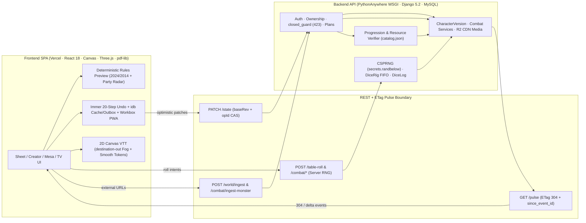
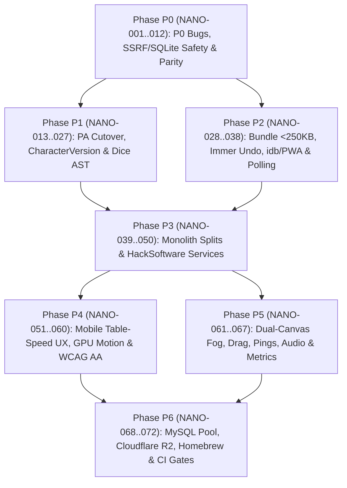

# Forja de Heróis — Frontend/Backend Logic Split, OSS Ground-Truth Evaluation & Nano-Grained Backlog

> **Baseline:** `v1.0.145` (`main`, 2026-11-28) · **Progress:** `32 / 72` full `NANO` items shipped + **all 5 FE-halves** of split items (`NANO-023` AST, `NANO-050` nav, `NANO-069` WebP, `NANO-071` Homebrew I/O, `NANO-072` Biome/budget CI gates); **0 remaining pure-FE tasks**  
> **Runtime Stack:** Vite 6.4.6 + React 18.3 + Immer 11 + `idb` 8 + `vite-plugin-pwa` + HTML5 2D Canvas + Three.js 0.186.1 + `pdf-lib` 1.17.1 Worker (Vercel Edge SPA) ↔ Python 3.12 + Django 5.2 + DRF + SQLite/MySQL (PythonAnywhere WSGI + `2.5s -> 30s` ETag HTTP `304` polling)  
> **Companion Specs:** [`ARCHITECTURE.md`](../ARCHITECTURE.md) · [`ROADMAP.md`](../ROADMAP.md) · [`TECH_DEBT.md`](../TECH_DEBT.md) · [`SYSTEM_MAP.md`](../SYSTEM_MAP.md) · [`docs/backlog-grooming-and-cascade-map.md`](backlog-grooming-and-cascade-map.md) · [`docs/sync-spec.md`](sync-spec.md) · [`docs/backend-handoff-feats.md`](backend-handoff-feats.md)

---

## 1. Architectural Principles & The 5 Golden Laws of the Split

Because **Forja de Heróis** serves players on intermittent mobile connections at a live tabletop (Vercel static SPA) while hosting campaign truth on a WSGI backend without WebSockets (PythonAnywhere Django 5.2), neither a naive thin-client nor a client-authoritative SPA works. Instead, logic and state split along five deterministic laws:

1. **Shared Rules Data + Dual Deterministic Validators; Server-Only Authority for Randomness & Secrets**
   - `frontend/data/` synced via `scripts/sync-rules.mjs` into `backend/api/progression/catalog.json` gives the browser zero-latency offline sheet previews (`computeAc`, `attackFor`, `applyAutosToCharacter`) while Python (`backend/api/progression/`) validates level-ups, feats, options, rests, and resources server-side.
   - To eliminate silent JS ↔ Python divergence, both runtimes must pass a shared JSON fixture suite in CI (`scripts/test_progression_parity.py`) *(a criar)*.
   - **Strictly Server-Owned:** Cryptographic RNG (`secrets.randbelow`), `DiceRig` FIFO queues, `inviteCode`, `dm_settings`, `closed_guard` (`423`), plan quotas (`plans.py`), and `WorldEntry` secret redaction (`world_rules.py`).
2. **Optimistic Local UX Reconciled by Monotonic Revision (`baseRev`) + `opId` Idempotency**
   - Sheet interactions (HP deltas, spell slots, resource pips, rests, conditions) apply immediately on the client through bounded 20-step JSON-Patch Undo/Redo (`immer`), while offline/in-flight mutations queue in IndexedDB (`idb`) with `{ baseRev, opId, patches }`.
   - `PATCH /api/characters/:id/state` checks `baseRev` on the server and returns HTTP `409 state_stale` with the current server document so the client rebases non-overlapping patches instead of silently overwriting DM combat HP write-backs.
3. **External Network Fetching, Scraping & CORS Proxying Are Strictly Server-Owned**
   - All outbound URL parsing, SSRF IP/scheme/redirect validation (`backend/api/world_ingest.py::check_url`), MediaWiki/HTML extraction, and image proxying (`backend/api/views_proxy.py`) live on Django (`POST /api/combat/ingest-monster` in `backend/api/monster_ingest.py`) *(a criar)*.
   - `frontend/src/campaigns/url-monster-importer.js` drops HTML/CORS scraping (`1,742` lines → `< 350` lines), retaining only pure offline statblock text parsing.
4. **Browser Storage Is an IndexedDB Cache & Outbox, Never Gameplay Truth**
   - `idb` + `vite-plugin-pwa` (Workbox) replace raw `localStorage` (which hits the `5 MB` quota after ~2 portrait uploads). Only ephemeral UI preferences (theme, collapsed panels, mute toggle) stay local-only; `CharacterVersion` snapshots, `beltConfig`, and `multiRollConfig` live on the server.
5. **Strict Module Budgets & Clean Service/Selector Layering**
   - **Frontend:** React UI components `<= 500` lines; pure domain engines `<= 500` lines; CSS domain stylesheets `<= 800` lines (GPU `transform` / `opacity` transitions only, semantic tokens only).
   - **Backend:** Thin DRF views (`<= 600` lines) delegating transactions to `backend/api/services/` *(a criar)* and read projections to `backend/api/selectors/` *(a criar)* (`HackSoftware/Django-Styleguide` pattern).

---

## 2. Authoritative 12-Domain Frontend vs. Backend Ownership Matrix

| # | Domain | Frontend Owns (Client SPA) | Backend Owns (Django / DB) | Sync & Wire Contract | Live Gap / Drift Uncovered |
|---|---|---|---|---|---|
| **1** | **Auth, Session & Access** | Auth screens (`frontend/src/auth/`), CSRF header injection, locked-campaign UI state | Session cookies, ownership/DM role checks, `closed_guard` (`423`), `inviteCode` redaction (`bc98391`), plan quotas (`plans.py`) | Session cookie + `X-CSRFToken`; `401`/`403`/`423` envelopes | `frontend/vite.config.js` `devCorsProxyPlugin` SSRF/host guard resolved (`v1.0.143`, `NANO-001`) |
| **2** | **Creation, Progression, Feats & Respec** | 17-step Wizard, instant AC/attack/spell slot preview, Timeline choice pickers (`feature-timeline.js`) | Authoritative `backend/api/progression/` validation against `catalog.json`, `backend/api/views_approvals.py::approval_review` / `approval_consume` | `POST /api/campaigns/:id/approvals`, `POST /characters/:id/resource` | `LevelUpModal.jsx` single-RNG fix shipped (`NANO-003`); `resources.py::compute_resources` `FEAT_RESOURCES` + `respec` approvals remain (`NANO-005`/`006`) |
| **3** | **Character Versions & Multi-Seats** | Version switcher UI (`VersionsModal.jsx`), read-only preview framing, forks UI | `CharacterVersion` *(a criar)* rows, `Membership` `version` FK *(a criar)*, HTTP `423 Locked` guard, portrait deduplication | `/api/characters/:id/versions/*` *(a criar)*, `resolve_sheet_target` selector *(a criar)* | `Character.data.versions` lives inside main JSON blob; `backend/api/models.py::Membership` lacks DB partial `UniqueConstraint` |
| **4** | **Live Sheet, Undo & Offline Sync** | `Immer` 20-step Undo (`undo-history.js`), `idb-store.js` cache, sticky 56px mobile hero, `MyTurnView.jsx`, Concentration guard, `HpDeltaPopover.jsx` | `PATCH /api/characters/:id/state` CAS check (`baseRev`, `opId`), atomic write-back | `{ baseRev, opId, patches }` → `200` or `409 state_stale` | `storage.js` decoupled from `srd.js` (`NANO-028`), Undo + `idb` shipped (`NANO-032`/`033`); `outbox-sync.js` *(a criar)* waits on `NANO-010` (`baseRev`) |
| **5** | **Dice Engine, Belt v2 & `DiceRig`** | Three.js die animation, 3–4–3 hex swipe/hold gestures, swappable `beltStore` adapter (`BeltHive.jsx`), shared Dice AST client parser | CSPRNG `secrets.randbelow`, `DiceRig` FIFO consumption, `DiceLog`/`DiaryEntry`, `beltConfig` / `multiRollConfig` persistence | `POST /api/characters/:pk/table-roll` (`campaign.data.rollQueue`, `rigged` flag hidden from player) | `BeltMultiRoll.jsx` & `MultiRoll.jsx` still save to `localStorage` until `D2` (`NANO-024`–`027`); `views_combat.py::combat_player_attack` pops `d20` rig on save spells (`NANO-004`) |
| **6** | **Tactical VTT, Fog & Pings** | Dual-canvas `destination-out` Fog rendering, `simplify-js` RDP brush strokes, 60 FPS pointer drag lerp, 4s ping ring | Encounter CAS turn lock, 20-deep undo (`views_combat.py`), `PATCH /fog`, `PATCH /token-move` ownership/turn guard, `POST /ping` | Normalized `fog.ops[]`, combat `rev` in Pulse | Fog brush, self-token drag, and pings remain unbuilt; `views_combat.py` is `2,714` lines (`NANO-048`, `NANO-061`–`063`) |
| **7** | **Monster & World URL Ingestion** | Pure offline statblock text/markdown paste parser (`< 350L`), aspect-locked map rects + lazy probe (`WorldMap.jsx`) | `backend/api/world_ingest.py::check_url`, `views_proxy.py`, unified server monster URL scraper *(a criar)* | `POST /api/campaigns/:id/world/ingest`, `POST /api/combat/ingest-monster` *(a criar)*, `GET /api/proxy` | `WorldMap.jsx` `imageAspect` probe shipped (`NANO-012`); `url-monster-importer.js` server migration stays queued (`NANO-037`) |
| **8** | **Living World, Atlas & NPC Sync** | World cards UI, hierarchical parent/child place navigation, local filter search | `views_world.py`, `world_rules.py` (`toLight` redaction of `secrets`/`dm_notes`), `views_campaigns.py::_sync_char_to_world_npc` | `/api/campaigns/:id/world`, `/world/:eid/echo` | `_sync_char_to_world_npc` reads `Character.data` instead of `Membership.version.data`; `world_rules.py` is `1,518` lines (`NANO-049`) |
| **9** | **Party Insights & Session Metrics** | 11-role radar & SWOT (`party-metrics.js`), bestiary vulnerability matching (`versus.js`), spotlight cards, post-session recap UI | Snapshot storage (`views_insights.py`) + Frente A4 server telemetry (`log_combat_end`, `/metrics/sessions` *(a criar)*) | `GET/POST /api/campaigns/:id/party-insights`, `GET /api/campaigns/:id/metrics/sessions` *(a criar)* | Frente A4 (`log_combat_end` + session metrics dashboard) still pending (`NANO-066`–`067`) |
| **10** | **Unified Stage, TV & Soundscapes** | `TVScreen.jsx` 1080p render, WebAudio synth loop player (`SoundscapeBar.jsx` + `soundscape-engine.js`), Wake Lock API, haptics | `stage.py`, `views_screen.py` unauthenticated `/tv/<token>`, 6-char `tv_code` pairing resolver *(a criar)* | `POST /api/campaigns/:id/stage`, `GET /api/screen/:token` | `SoundscapeBar.jsx` + `wake-lock.js` shipped (`NANO-055`, `NANO-065`); `tv_code` pairing waits (`NANO-064`) |
| **11** | **Real-Time Sync (`Pulse`)** | `polling.js` exponential backoff (`2.5s -> 30s` + jitter), `visibilitychange` wake-up, `online` reset (`table-store.js`) | Strictly read-only `GET /api/campaigns/:id/pulse` (`ETag` + `304`, `?since_event_id`) — zero session/DB writes | `If-None-Match` ETag + incremental event cursor | Client backoff & recovery shipped (`NANO-036`); server `?since_event_id` ring buffer (`TableEvent`) remains (`NANO-038`) |
| **12** | **PDF, Bundles, DB & Media Storage** | Lazy Web Worker (`pdf.worker.js`), Vite `pickChunk` (`app` `107.23 kB` gz), `vite-plugin-pwa` SW | PythonAnywhere NFS-safe SQLite (`timeout: 20`) → Pooled MySQL (`CONN_MAX_AGE=60`), Cloudflare R2 `storage_r2.py` *(a criar)* | Binary avatar/map URLs, S3v4 presigned PUT URLs *(a criar)* | FE bundle/PWA/Worker shipped (`NANO-028`–`031`, `035`); WAL hazard on PA NFS SQLite & R2 media offload remain (`NANO-002`, `068`–`070`) |

---

## 3. OSS Ground-Truth Evaluation & Adversarial Debate Council Synthesis

> **Adversarial Verification (`debate-council` T1 Trio: GLM 5.3 + DeepSeek V4.1 + MiMo V2.6, Chaired by Gemma 4):**
> Every major architecture and library decision below was stressed-tested before selection:
> - **1A (`Immer` + `idb`) beat Yjs CRDT (`1C`) & Dexie (`1B`):** Over `2.5s` HTTP polling without WebSockets, a CRDT adds ~25 KB + operational complexity for phantom real-time co-editing; `Immer` `produceWithPatches` + `idb` gives instant 20-step Undo and compact patch queues in ~6 KB total. *Guardrail:* Revisit Yjs only if collaborative multi-author rich-text world notes are ever introduced.
> - **2A (Dual Canvas `destination-out` + RDP vector `ops[]`)** unanimously beat `react-konva` and PNG masks for mobile FPS and tiny HTTP polling payloads.
> - **3A (Shared `catalog.json` + Dual JS/Python Validators)** unanimously beat thin-client RPC and client-only math, *provided* CI runs a cross-runtime parity harness (`scripts/test_progression_parity.py` *(a criar)*) and server `baseRev` CAS prevents `2.5s` poll interleaving.
> - **4A (Pooled MySQL + NFS-Safe SQLite Fallback)** unanimously exposed the critical bug in `ARCHITECTURE.md` §5: SQLite `PRAGMA journal_mode=WAL` on PythonAnywhere's NFS home directory corrupts databases via broken `-shm` mmap locking! Use SQLite `DELETE` journal + `timeout: 20` on PA free tier until MySQL cutover, restricting WAL strictly to local SSD development.

| Capability | Candidates Evaluated (GitHub / License / Weight) | Rejected Alternatives & Why | Selected Target & Forja Adaptation Blueprint |
|---|---|---|---|
| **Undo/Redo & State Diffs** | `immerjs/immer` (MIT, ~5 KB gz), `Starcounter-Jack/JSON-Patch` (MIT), `yjs/yjs` (MIT, ~25 KB), deep `structuredClone` snapshots | `structuredClone` duplicates 200 KB+ character blobs (`localStorage`/GC stalls); `Yjs` requires WebSocket awareness to shine and over-complicates sheet JSON schemas | **`immer` (`produceWithPatches` / `applyPatches`)** in `frontend/src/sheet/undo-history.js` (shipped `v1.0.143`): keeps a 20-step reversible patch stack for `"Desfazer (Ctrl+Z)"` toasts and emits compact patch payloads for future outbox rebasing |
| **Offline Storage & PWA Cache** | `jakearchibald/idb` (ISC, ~1.2 KB) + `vite-pwa/vite-plugin-pwa` (MIT), `dexie/Dexie.js` (~28 KB), `@tanstack/react-query-persist-client`, raw `localStorage` | Raw `localStorage` crashes at `5 MB` on base64 portraits; `Dexie` + React Query would force rewriting `storage.js` and `table-store.js` around external query keys | **`idb` + `vite-plugin-pwa` (Workbox `generateSW`)**: drop-in async stores (`characters`, `versions`, `assets`, `outbox`) preserving `storage.js` API while caching SRD JSONs, audio, and fonts `CacheFirst` |
| **VTT Fog & Canvas Interaction** | Native Dual-Canvas (`owlbear-rodeo/owlbear-rodeo-legacy` MIT & `Kruptein/PlanarAlly` MIT patterns) + `mourner/simplify-js` (BSD-2, ~1 KB), `konvajs/react-konva` (~55 KB), `fabricjs/fabric.js` (~95 KB), raster PNG fog | `Konva`/`Fabric` add 55–95 KB + slower full-scene-graph redraws on mobile Safari; raster PNG fog inflates Django/SQLite polling payloads | **Native Offscreen Fog Canvas (`destination-out`) + `simplify-js` RDP** inside `frontend/src/campaigns/CombatGrid.jsx` & `frontend/src/screen/TVScreen.jsx`: serializes compact normalized vector `ops[]` (`circle`/`rect`/`poly`) and lerps token drags via `useRef` + `requestAnimationFrame` |
| **Dice Notation AST & Parity** | Shared Recursive-Descent AST (grounded in `dice-roller/rpg-dice-roller` MIT & `RoleSave/dparse` MIT), ad-hoc regex (`dice-text.js`), `chevrotain` (~35 KB) | Regexes break on nested `kh1`/`kl1`/`ro<2` modifiers; `chevrotain` is excess bundle weight | **Tiny Zero-Dep Recursive-Descent Grammar**: `frontend/src/dice/dice-ast.js` + `frontend/data/dice-ast-vectors.json` shipped (`v1.0.145`); `backend/api/dice_ast.py` *(a criar)* mirrors the same vectors server-side |
| **Backend Modularity & DB Concurrency** | `HackSoftware/Django-Styleguide` (`services/` + `selectors/`), `psycopg`/`mysqlclient` + SQLite `OPTIONS: timeout=20`, SQLite WAL on PA NFS, Django Channels + Redis | PythonAnywhere free/WSGI does not support ASGI WebSockets or Redis daemons; SQLite WAL on NFS risks `database disk image is malformed` | **HackSoftware Service/Selector Split + Pooled MySQL (`CONN_MAX_AGE=60`, `STRICT_TRANS_TABLES`)**: extract services from `views_combat.py` / `world_rules.py` now; enforce `timeout: 20` on NFS SQLite before MySQL cutover |
| **Media Storage Offload** | Direct Client Upload via S3v4 Presigned URLs (`boto3` minimal signer, Apache-2.0) + `OffscreenCanvas` WebP resize, `django-storages` server-proxied, DB base64 blobs | Server-proxied uploads block scarce PythonAnywhere WSGI workers; DB base64 bloats SQL dumps and triggers `413` errors | **Cloudflare R2 Presigned Direct PUT (`backend/api/storage_r2.py`)** *(a criar)* + client WebP compression (`frontend/src/world/image.js`): maps, tokens, and avatars upload directly to R2 CDN |
| **Table-Speed UX & Visual Polish** | Local `F:\AI_Tools` stack (`emilkowalski__skills` + `foss-creative-layers` GPU motion tokens, `Nutlope__hallmark` `sloplint`, `cosscom__ui` + `guiguiyan930-source__game-ui-design-workflow`, `floating-ui/dom` ~3 KB + `focusTrap.js`), MUI/Chakra | Heavy React UI kits fight custom forged-parchment tokens and bloat bundle size | **Surgical CSS Tokens + GPU Motion + `Operate` Action Cards**: 56px mobile hero strip, 5-tab thumb nav, `My Turn` view, `grid-template-rows` / `transform` transitions, `>= 44x44px` hit boxes |
| **Quality, Parity & Bundle Gates** | `biomejs/biome` (installed locally at `F:\AI_Tools\npm\biome.cmd`), custom `check_doc_refs.py`, bundle budget script, parity runner | ESLint + multiple plugins add heavy config & slow CI cycles | **Unified `hf_ops.py verify` + `scripts/check_bundle_budget.mjs`** (shipped `v1.0.143`) + **`scripts/test_progression_parity.py`** *(a criar)* |

---

## 4. Ordered Nano-Grained Actionable Backlog (`NANO-001` through `NANO-072`)

### Dependency & Precedence Flow (Waves / Phases P0 → P6)

### Phase P0 — Live Bugs, Security Hardening & Dual-Engine Parity (`NANO-001`–`NANO-012`)

| ID | Prio | Depends On | Layer | Target Files & Nano-Action | Cascade & Verification Command |
|---|---|---|---|---|---|
| `NANO-001` | P0 `[SHIPPED v1.0.143]` | — | FE/Dev | Hardened `devCorsProxyPlugin` in `frontend/vite.config.js`: `server.host` defaults to `127.0.0.1`, same-origin CORS only, `isPrivateHost` / `isSafeProxyUrl` matching `backend/api/world_ingest.py::check_url` | Prevents LAN SSRF during `npm run dev` · `cd frontend && npm run build` |
| `NANO-002` | P0 | — | BE | Set `OPTIONS: {'timeout': 20}` on SQLite in `backend/forja/settings.py`; gate `PRAGMA journal_mode=WAL` behind opt-in `FORJA_SQLITE_WAL=1` (local SSD only, never PythonAnywhere NFS) | Eliminates PA NFS DB corruption & lock spikes · `hf_ops.py verify` |
| `NANO-003` | P0 `[SHIPPED v1.0.143]` | — | FE | Fixed double-RNG bug in `frontend/src/progression/LevelUpModal.jsx`: invokes `window.__diceRoll` once and commits `entry?.groups?.[0]?.rolls?.[0]` (with crypto fallback) to `rolled` | Eliminates die display vs applied HP mismatch · `npm test` |
| `NANO-004` | P0 | — | BE | Move `_maybe_consume_rig` (`L1986`) inside the `else:` attack-roll branch inside `backend/api/views_combat.py::combat_player_attack` | Stops saving-throw spells from burning queued `d20` rigs · combat backend tests |
| `NANO-005` | P0 | — | BE | Load `FEAT_RESOURCES` in `backend/api/progression/resources.py::compute_resources` so `feat.lucky`, `feat.martialAdept`, `feat.metamagicAdept` spend/rest server-side | Closes `backend-handoff-feats.md` Gap 1 · `manage.py test api.tests.test_progression` |
| `NANO-006` | P0 | `NANO-005` | BE | Support `approval_type == 'other'` (`payload.kind == 'respec'`) in `backend/api/progression/engine.py::apply_approval_to_character` + `backend/api/views_approvals.py::approval_review` / `approval_consume` | Closes `backend-handoff-feats.md` Gap 2 (`✎ Trocar`) · approval tests |
| `NANO-007` | P0 | `NANO-005`, `NANO-006` | OPS/CI | Create cross-runtime golden fixture suite `scripts/test_progression_parity.py` *(a criar)* running identical `2024`/`2014` inputs through JS & Python progression | Prevents silent JS/Python rule drift (Council Blindspot #1) · `py scripts/test_progression_parity.py` *(a criar)* |
| `NANO-008` | P0 | — | BE | Add partial `UniqueConstraint(fields=['campaign', 'character'], condition=Q(character__isnull=False))` on `backend/api/models.py::Membership` + migration `backend/api/migrations/0016_membership_unique_campaign_character.py` *(a criar)*; delete dead `_wants_move` helpers in `views_campaigns.py` | Closes concurrent double-seat race condition · `manage.py makemigrations --check` |
| `NANO-009` | P0 | — | OPS | Emit `VERSION.json` during GitHub codeload fallback inside `scripts/self_update.py::fetch_package` (`sync-spec` `A4`) | Fixes stale deployed SHA reporting on PA · unit test in `api.tests.test_self_update` |
| `NANO-010` | P0 | — | BE | Add monotonic `baseRev` + `opId` CAS guard on `PATCH /api/characters/:id/state` in `backend/api/views_characters.py`, returning `409 state_stale` + latest server doc on conflict | Enables deterministic outbox rebase (Council Blindspot #2) · character state API tests |
| `NANO-011` | P0 `[SHIPPED v1.0.143]` | — | FE | Resolved `source-map-js` & `vite` advisories via `npm audit fix` (`immer`, `idb`, `vite-plugin-pwa` installed) | 0 high/critical vulnerabilities · `cd frontend && npm audit --audit-level=high` |
| `NANO-012` | P0 `[SHIPPED v1.0.143]` | — | FE | Added lazy `fetchImageRatio` background probe + `aspectCacheRef` + `entry.data.imageAspect` persistence in `frontend/src/world/WorldMap.jsx` | Ensures `Auto-Fit Ratio` works deterministically · `npm test` + `vite build` |

### Phase P1 — Production Backend Cutover, Server `CharacterVersion` & Unified Dice AST (`NANO-013`–`NANO-027`)

| ID | Prio | Depends On | Layer | Target Files & Nano-Action | Cascade & Verification Command |
|---|---|---|---|---|---|
| `NANO-013` | P1 | `NANO-002`, `NANO-008`, `NANO-009` | OPS | Configure `FORJA_UPDATE_KEY_SHA256` on PythonAnywhere and deploy `main` via `POST /api/ops/update` (`sync-spec` `A1`–`A3`) | Eliminates production frontend-ahead-of-backend drift · `/api/health` SHA check |
| `NANO-014` | P1 | `NANO-013` | OPS | Run smoke verification across all 26 Tier-2 routes (`/pulse`, `/stage`, `/party-insights`, `/combat/.../undo`, `/world/ingest`, `/proxy`, `/table-roll`) (`A5`–`A6`) | Verifies production WSGI parity · `hf_ops.py verify --full` |
| `NANO-015` | P1 | `NANO-014` | FE | Remove all 47 `isOldServer` / `"servidor antigo"` fallback branches across 30 files (`errors.js`, `B11` `npc-link.js`, `B12` client pact-slot rest shim) (`B1`–`B5`) | Deletes dual-path maintenance burden · `rg -n "servidor antigo" frontend/src/` == 0 |
| `NANO-016` | P1 | `NANO-008` | BE | Define `CharacterVersion` model (`D1.1`) and add `version` FK *(a criar)* on `backend/api/models.py::Membership` (`D1.2`) + schema migration *(a criar)* | Normalizes campaign-scoped character snapshots · `manage.py makemigrations --check` |
| `NANO-017` | P1 | `NANO-016` | BE | Implement `backend/api/views_versions.py` *(a criar)* (`GET/POST /versions`, `PATCH /versions/:vid`, `POST /checkout`, `POST /fork`, `POST /import-snapshot` — `D1.3`–`D1.8`) | Replaces `Character.data.versions` shim · version API test module *(a criar)* |
| `NANO-018` | P1 | `NANO-017` | BE | Enforce HTTP `423 Locked` (`version_read_only`) on `left` and `archived` versions across `backend/api/views_characters.py` & `backend/api/views_versions.py` *(a criar)* (`D1.9`) | Prevents tampering with frozen campaign sheets · `423` permission tests |
| `NANO-019` | P1 | `NANO-017` | BE | Hook campaign archival in `backend/api/views_campaigns.py` to freeze active `CharacterVersion` rows (`status='archived'`) (`D1.10`) | Preserves campaign history read-only · campaign close tests |
| `NANO-020` | P1 | `NANO-017` | BE | Create `resolve_sheet_target(character, campaign)` selector in `backend/api/selectors/sheets.py` *(a criar)* and route all 10 gameplay consumers (`views_combat`, `_sync_char_to_world_npc`, `views_insights`, `views_checks`, `table_rolls`, `views_screen`, `serializers`) through it (`D1.11`) | Zero cross-table character leak · full BE test suite + NPC sync test |
| `NANO-021` | P1 | `NANO-020` | FE+BE | Write idempotent Django data migration unpacking legacy `Character.data.versions` (`D1.12`) and switch `frontend/src/sheet/versions.js` + `VersionsModal.jsx` to `/versions` endpoints | Completes `CharacterVersion` cutover · FE version tests + migration rollback test |
| `NANO-022` | P1 | `NANO-017` | BE | Deduplicate portraits via `_avatarSame` + ETag binary endpoint `GET /api/characters/:id/versions/:vid/avatar` *(a criar)* (`D3.1`–`D3.2`) | Eliminates multi-MB base64 duplication & `413` errors · avatar ETag test |
| `NANO-023` | P1 `[FE SHIPPED v1.0.145]` | — | FE+BE | Built FE recursive-descent Dice AST in `frontend/src/dice/dice-ast.js` + 20 vectors in `frontend/data/dice-ast-vectors.json` (`khN`, `klN`, `dlN`, `ro`, `r`, `min`, crit doubling); mirror `backend/api/dice_ast.py` *(a criar)* remains | Unifies dice notation across Belt v2, `MultiRoll`, and `DiceRig` · `frontend-wave-e-final.test.js` |
| `NANO-024` | P1 | `NANO-023`, `NANO-014` | BE | Extend `POST /api/characters/:pk/table-roll` in `backend/api/table_rolls.py` for multi-group & crit extra dice (`D2.1`) and `DiceLog`/`DiaryEntry` entries (`D2.2`) | Live multiattack & paired roll broadcasts to TV · `test_table_rolls` |
| `NANO-025` | P1 | `NANO-024` | BE | Consume queued `DiceRig` values per die across composite multi-group rolls inside `backend/api/table_rolls.py` (`D2.3`) | Prevents rigged dice bypass during multiattack · `DiceRig` composite tests |
| `NANO-026` | P1 | `NANO-020` | FE+BE | Persist `beltConfig` and `multiRollConfig` inside `CharacterVersion.data` / `Character.data` with one-time migration from `localStorage` (`D2.4`) | Syncs hex belt loadouts `I`/`II` across devices · character serializer + Sheet tests |
| `NANO-027` | P1 | `NANO-024`, `NANO-025`, `NANO-026` | FE | Connect `frontend/src/dice/BeltMultiRoll.jsx` and `frontend/src/dice/MultiRoll.jsx` to `POST /api/characters/:pk/table-roll` when inside a campaign (`D2.5`) | Full tabletop TV & DM audit parity · dice integration tests |

### Phase P2 — Bundle `< 250 kB` Gzip, Immer Undo, `idb`/PWA Outbox & Resilient Polling (`NANO-028`–`NANO-038`)

| ID | Prio | Depends On | Layer | Target Files & Nano-Action | Cascade & Verification Command |
|---|---|---|---|---|---|
| `NANO-028` | P1 `[SHIPPED v1.0.143]` | — | FE | Extracted `frontend/src/api/char-card-summary.js` and `frontend/data/spell-id-aliases.js` so `frontend/src/api/storage.js` `list()`/`get()` avoid importing `srd.js` + `utils.js` | Cuts Home login TTI · Vite build + `npm test` |
| `NANO-029` | P1 `[SHIPPED v1.0.143]` | — | FE | Unified `SpeciesChoices.jsx` (`species-summary.js`) and `LiveScreenSheet.jsx` (`LiveScreenParts.jsx`) imports & converted heavy routes/modals to `React.lazy` + `<Suspense>` | 0 Rollup chunk collision warnings · `cd frontend && npm run build` |
| `NANO-030` | P1 `[SHIPPED v1.0.143]` | `NANO-028`, `NANO-029` | FE+CI | Configured `pickChunk` in `frontend/vite.config.js` (`vendor-react`, `vendor-three`, `vendor-pdf`, `vendor-state`, `srd`, `srd-spells-2024`, `srd-spells-extra`, `srd-magic-items`, `srd-bestiary`, `srd-subclasses`, `progression`) + `scripts/check_bundle_budget.mjs` (`104.7 KiB` / `107.23 kB` gz <= `250 kB`) | Cuts entry chunk by `> 80%` · `node scripts/check_bundle_budget.mjs` |
| `NANO-031` | P2 `[SHIPPED v1.0.143]` | `NANO-030` | FE | Moved `pdf-lib` export/import execution into Web Worker `frontend/src/pdf/pdf.worker.js` via `frontend/src/pdf/pdf-runner.js` with transparent main-thread fallback | Keeps UI at 60 FPS during PDF export/import · PDF build & `npm test` |
| `NANO-032` | P1 `[SHIPPED v1.0.143]` | — | FE | Added `immer` (`produceWithPatches`, `applyPatches`) 20-step undo/redo engine in `frontend/src/sheet/undo-history.js` + `Ctrl+Z` / `"Desfazer (Ctrl+Z)"` toast in `Sheet.jsx` | Zero lost HP/slot misclicks at the table · `frontend-infra-wave-bd.test.js` |
| `NANO-033` | P1 `[SHIPPED v1.0.143]` | `NANO-032` | FE | Added `idb` wrapper `frontend/src/api/idb-store.js` (`characters`, `versions`, `assets`, `outbox`) with one-time `localStorage` migration (`storage.js`) | Eliminates `5 MB` `localStorage` quota crashes · `frontend-infra-wave-bd.test.js` |
| `NANO-034` | P1 | `NANO-010`, `NANO-032`, `NANO-033` | FE | Build `frontend/src/api/outbox-sync.js` *(a criar)* queuing offline sheet mutations (`{ baseRev, opId, patches }`), draining on `online` and rebasing non-overlapping Immer patches on `409 state_stale` | Guarantees offline-first survival without silent data loss · outbox rebase tests *(a criar)* |
| `NANO-035` | P2 `[SHIPPED v1.0.143]` | `NANO-030`, `NANO-033` | FE | Configured `vite-plugin-pwa` (`generateSW`, 145 precache entries: `CacheFirst` `/data/` & media; `NetworkFirst` `/api/`) in `frontend/vite.config.js` | Full offline SRD & sheet shell loading · Workbox output in `npm run build` |
| `NANO-036` | P1 `[SHIPPED v1.0.143]` | — | FE | Upgraded `frontend/src/api/polling.js` (`computeBackoffMs`: `2.5s -> 30s` + $\pm 15\%$ jitter, `online`/`visibilitychange` reset) & wired into `frontend/src/play/table-store.js` | Replaces silent fixed retry storms · `frontend-infra-wave-bd.test.js` |
| `NANO-037` | P2 | `NANO-001` | FE+BE | Move monster URL/HTML scraping to `backend/api/monster_ingest.py` *(a criar)* (`POST /api/combat/ingest-monster` reusing `world_ingest.py::check_url`), shrinking `frontend/src/campaigns/url-monster-importer.js` (`1,742L → < 350L`) | Eliminates brittle client CORS relays + 1.4k frontend lines · monster ingest tests |
| `NANO-038` | P2 | `NANO-036` | BE | Add `TableEvent` *(a criar)* bounded ring table + `?since_event_id=<id>` cursor parameter to `backend/api/views_pulse.py` | Cuts repeated campaign payload parsing on every `2.5s` pulse · `views_pulse` tests |

### Phase P3 — Monolith Decomposition & HackSoftware Service/Selector Extraction (`NANO-039`–`NANO-050`)

| ID | Prio | Depends On | Layer | Target Files & Nano-Action | Cascade & Verification Command |
|---|---|---|---|---|---|
| `NANO-039` | P1 `[SHIPPED v1.0.143]` | `NANO-029` | FE | Extracted `frontend/src/sheet/hero/SheetHero.jsx` from `frontend/components/Sheet.jsx` and deleted dead `BeltPbSlot` | Isolates header/portrait/rests/actions cleanly · Sheet tests + build |
| `NANO-040` | P1 `[SHIPPED v1.0.143]` | `NANO-039`, `NANO-026` | FE | Extracted `frontend/src/sheet/belt/BeltHive.jsx`, `BeltHex.jsx`, and `BeltQuickSlot.jsx` with swappable `beltStore` adapter prop | Modularizes 3–4–3 Honeycomb Belt v2 · Belt tests |
| `NANO-041` | P1 `[SHIPPED v1.0.143]` | `NANO-039` | FE | Extracted `frontend/src/sheet/tabs/SheetSkillsSection.jsx`, `SheetFeaturesSection.jsx`, `SheetPlay.jsx`, and `TimelineModals.jsx` | Isolates action groups & timeline choice/respec UI · skills/features tests |
| `NANO-042` | P1 `[SHIPPED v1.0.145]` | `NANO-040`, `NANO-041` | FE | Extracted `frontend/src/sheet/tabs/SheetCompanionsAndNotes.jsx` & `frontend/src/sheet/use-sheet-hooks.js`, shrinking `frontend/components/Sheet.jsx` (`5,469L -> 474L`) | Restores `< 500L` sheet orchestrator · all Sheet test suites |
| `NANO-043` | P1 `[SHIPPED v1.0.143]` | `NANO-039` | FE | Extracted `frontend/src/sheet/spells/UnifiedSpellsHUD.jsx`, `SlotMatrix.jsx`, `SpellRow.jsx`, `RestButtons.jsx` (+ `rest-summary.js`), and `SpellViews.jsx` from `SheetTabs.jsx` | Decouples Long-Rest vs Pact Magic slot matrix & spell accordions · spell UI tests |
| `NANO-044` | P1 `[SHIPPED v1.0.143]` | `NANO-043` | FE | Extracted `frontend/src/sheet/inventory/SheetInventoryTab.jsx`, `InventoryList.jsx`, and `frontend/src/sheet/story/SheetStoryTab.jsx`, reducing `SheetTabs.jsx` to `8L` barrel | Eliminates second FE monolith · SheetTabs & inventory tests |
| `NANO-045` | P2 `[SHIPPED v1.0.145]` | — | FE | Extracted `SceneChecklistDrawer.jsx`, `EncounterLauncher.jsx`, `SessionSummaryHeader.jsx`, `NextSessionSteps.jsx`, `NextSessionOverlays.jsx`, and `use-next-session-sync.js`, shrinking `frontend/src/prep/NextSession.jsx` (`1,441L -> 369L`) | Meets `< 500L` budget · `vite build` |
| `NANO-046` | P2 `[SHIPPED v1.0.143]` | `NANO-042`, `NANO-044` | FE | Split `frontend/src/sheet/ficha.css` (`7,381L -> 15L` manifest) into 14 ordered domain stylesheets under `frontend/src/sheet/css/` | Enforces `< 800L` CSS budget & token discipline · Vite CSS build + tests |
| `NANO-047` | P2 `[SHIPPED v1.0.143]` | `NANO-046` | FE | Split `frontend/styles.css` (`2,768L -> 6L` manifest) into `frontend/src/styles/{tokens,base,catalog,overlays,modals}.css` | Removes legacy root stylesheet coupling · Vite build |
| `NANO-048` | P1 | `NANO-020`, `NANO-004` | BE | Refactor `backend/api/views_combat.py` (`2,714L → < 550L`) using `HackSoftware/Django-Styleguide` into `backend/api/services/` *(a criar)* (`combat_setup.py`, `combat_undo.py`, `combat_actions.py`, `combat_media.py`) | Isolates HTTP validation from combat state machines · combat test suite |
| `NANO-049` | P2 | `NANO-020` | BE | Split `backend/api/world_rules.py` (`1,518L → < 500L`) into `backend/api/services/` *(a criar)* (`world_visibility.py`, `world_linter.py`, `world_npc_sync.py`) | Clean world redaction & lore graph rules · `test_world` suite |
| `NANO-050` | P2 `[FE-NAV SHIPPED v1.0.145]` | `NANO-015` | FE | Migrated `CombatTab.jsx` & `EndOfEncounterPanel.jsx` to native `goTo(area, sub)` & deprecated `LEGACY_TAB_TO_AREA`; deleting `shell-logic` shims, `frontend/src/shell/legacy/`, and `frontend/src/stage/stage-api.js` waits on `NANO-015` | Clears navigation dispatchers · `shell-logic.test.js` |

### Phase P4 — Mobile Table-Speed UX, GPU Motion & WCAG 2.2 AA Hardening (`NANO-051`–`NANO-060`)

| ID | Prio | Depends On | Layer | Target Files & Nano-Action | Cascade & Verification Command |
|---|---|---|---|---|---|
| `NANO-051` | P1 `[SHIPPED v1.0.143]` | `NANO-039`, `NANO-046` | FE | Built `MobileStickyHero` (`Name · Lv · HP · AC · Conditions`) + `Jump-to` chip bar inside `frontend/src/sheet/hero/SheetHero.jsx` + `IntersectionObserver` in `Sheet.jsx` | Cuts mobile time-to-HP to 0ms · `vite build` & FE tests |
| `NANO-052` | P1 `[SHIPPED v1.0.143]` | `NANO-042`, `NANO-051` | FE | Added thumb-reachable mobile 5-tab bar in `frontend/src/sheet/MobileSheetNav.jsx` (`Combate · Magias · Perícias · Mochila · História`) | One-handed portrait play ergonomics · `vite build` & FE tests |
| `NANO-053` | P1 `[SHIPPED v1.0.143]` | `NANO-041`, `NANO-043` | FE | Created **`My Turn` (`Meu Turno`) Action-Economy View** in `frontend/src/sheet/MyTurnView.jsx` grouping weapons, spells & features by `Action`/`Bonus`/`Reaction`/`Free` (mounted in `SheetPlay.jsx`) | Eliminates tab-hopping during live combat turns · `frontend-infra-wave-bd.test.js` |
| `NANO-054` | P1 `[SHIPPED v1.0.143]` | `NANO-032`, `NANO-053` | FE | Wired automatic Concentration Check banner (`DC = max(10, floor(damage / 2))`) in `Sheet.jsx` when HP drops during concentration | Zero forgotten Concentration checks · `frontend-infra-wave-bd.test.js` |
| `NANO-055` | P2 `[SHIPPED v1.0.143]` | — | FE | Added `frontend/src/utils/wake-lock.js` (`useWakeLock` in `Sheet.jsx` + `triggerHaptic` in `DiceRoller.jsx` & `journey-ui.jsx`) | Prevents phone dimming mid-encounter with graceful fallback · `frontend-infra-wave-bd.test.js` |
| `NANO-056` | P1 `[SHIPPED v1.0.143]` | `NANO-046`, `NANO-047` | FE | Replaced 12 layout-thrashing CSS transitions (`width`, `height`, `max-height`, `margin-top`, `all`) across `src/styles/*.css`, `creator.css`, `tv-styles.css` (`TVScreen.jsx`), and `shell.css` (`Onboarding.jsx`) | Eliminates main-thread layout jank · `vite build` + biome check |
| `NANO-057` | P1 `[SHIPPED v1.0.143]` | `NANO-046` | FE | Expanded undersized hit targets (`>= 44x44px`) in `frontend/src/creator/join-table.css`, `frontend/src/app-extra-styles.css`, `sheet-skills-features.css`, `sheet-spells.css`, and `sheet-polish.css` | Accessible mobile tap precision · CSS + `vite build` |
| `NANO-058` | P2 `[SHIPPED v1.0.143]` | `NANO-051`, `NANO-032` | FE | Added `frontend/src/sheet/HpDeltaPopover.jsx` (`-10, -5, -1, +1, +5, +10` quick keypad) anchored to HP & Temp HP pills in `SheetHero.jsx` | Avoids OS virtual keyboard occluding the sheet · `frontend-infra-wave-bd.test.js` |
| `NANO-059` | P2 `[SHIPPED v1.0.145]` | `NANO-023` | FE | Upgraded `frontend/src/shell/QuickSearch.jsx` (`Cmd/Ctrl+K`) with `frontend/src/shell/quick-actions.js` slash actions (`/r`, `/cond`, `/cast`) | Power-user keyboard speed · `frontend-wave-e-final.test.js` |
| `NANO-060` | P2 `[SHIPPED v1.0.143]` | `NANO-056`, `NANO-057` | FE/CI | Ran `F:\AI_Tools\npm\biome.cmd lint` across all 11 new JS/JSX modules (0 errors) | Cleans dead code & lint hygiene · `biome.cmd lint` exit 0 |

### Phase P5 — Interactive VTT Canvas, TV Pairing, Soundscapes & Session Analytics (`NANO-061`–`NANO-067`)

| ID | Prio | Depends On | Layer | Target Files & Nano-Action | Cascade & Verification Command |
|---|---|---|---|---|---|
| `NANO-061` | P2 | `NANO-048`, `NANO-038` | FE+BE | Implement dual-layer Canvas Fog of War (`globalCompositeOperation = 'destination-out'` offscreen mask + RDP stroke compression) in `CombatGrid.jsx` (40% DM overlay) & `TVScreen.jsx` (100% `#0d0906`) persisted via `PATCH /api/combat/campaign/:id/fog` | Zero-lag fog brush over HTTP polling · fog op serializer + Canvas tests |
| `NANO-062` | P2 | `NANO-061` | FE+BE | Implement 60 FPS `useRef` pointer Player Token Dragging + `requestAnimationFrame` lerp + distance ruler in `CombatGrid.jsx`, backed by `PATCH /api/combat/campaign/:id/token-move` (`playersMoveTokens`, `moveOnlyOnTurn`) | Smooth collaborative tactical positioning · token ownership/turn tests |
| `NANO-063` | P2 | `NANO-061`, `NANO-038` | FE+BE | Add `350ms` long-press / Alt+Click Map Ping (`POST /api/campaigns/:id/ping`) rendering a 4-second expanding radial pulse across `CombatGrid.jsx`, `WorldMap.jsx`, and `TVScreen.jsx` | Shared focus pointer for table & TV · ping endpoint + Pulse tests |
| `NANO-064` | P2 | `NANO-014` | FE+BE | Add 6-char human-friendly TV pairing code (`tv_code`, `GET /api/screen/pair/:code` in `backend/api/views_screen.py` + `frontend/src/screen/TvPairScreen.jsx`) *(a criar)* | Effortless smart-TV setup without copying URLs · screen pairing test |
| `NANO-065` | P2 `[SHIPPED v1.0.143]` | `NANO-035` | FE | Created WebAudio ambient synthesizer `frontend/src/stage/SoundscapeBar.jsx` + `frontend/src/stage/soundscape-engine.js` with 6 cross-faded presets (`tavern`, `dungeon`, `forest`, `storm`, `boss`, `crypt`) wired to `LiveScreenSheet.jsx` & `TVScreen.jsx` | Diegetic table atmosphere · TV mute/volume sync check |
| `NANO-066` | P2 | `NANO-048` | BE | Implement Frente A4 session metrics inside `backend/api/services/combat_actions.py` *(a criar)* (`log_combat_end`: encounter CR, XP budget, rounds, damage dealt/taken, healing, downs) + `GET /api/campaigns/:id/metrics/sessions` in `backend/api/views_insights.py` | Grounds post-session summaries in real encounter numbers · metrics aggregation tests |
| `NANO-067` | P2 | `NANO-066` | FE | Build Post-Session Recap & MVP Card (`frontend/src/group/SessionRecapPanel.jsx`) *(a criar)* rendering Frente A4 stats alongside `DiaryEntry` highlights | Completes Frente A (`PLANO-MESA-E-METRICAS.md`) · recap UI test |

### Phase P6 — Production Scale Infrastructure, R2 Media & Homebrew Ecosystem (`NANO-068`–`NANO-072`)

| ID | Prio | Depends On | Layer | Target Files & Nano-Action | Cascade & Verification Command |
|---|---|---|---|---|---|
| `NANO-068` | P3 | `NANO-002`, `NANO-016` | BE/OPS | Configure pooled MySQL (`CONN_MAX_AGE = 60`, `STRICT_TRANS_TABLES`, `utf8mb4_0900_ai_ci`) in `backend/forja/settings.py` and document verified `dumpdata`/`loaddata` cutover runbook in `DEPLOY.md` | Eliminates PythonAnywhere SQLite write contention · `manage.py check --deploy` |
| `NANO-069` | P3 `[FE SHIPPED v1.0.145]` | `NANO-022` | FE+BE | Added `OffscreenCanvas` WebP resize/compression (`supportsWebp`, `compressImageToWebp`) in `frontend/src/world/image.js`; S3v4 presigned signer `backend/api/storage_r2.py` *(a criar)* remains | Immediate client payload savings before R2 cutover · `frontend-wave-e-final.test.js` |
| `NANO-070` | P3 | `NANO-069` | BE/OPS | Create management command `backend/api/management/commands/offload_base64_media.py` *(a criar)* migrating historical base64 portraits, maps, and tokens to R2 CDN URLs | Shrinks relational DB size by `> 80%` · dry-run migration test |
| `NANO-071` | P3 `[FE SHIPPED v1.0.145]` | `NANO-030` | FE+BE | Built Homebrew Content Bundle Exporter/Importer/Validator (`frontend/src/homebrew/bundle-io.js`) for monsters, spells & items; server endpoint `POST /api/campaigns/:id/homebrew/import` *(a criar)* remains | Portable DM homebrew packs · `frontend-wave-e-final.test.js` |
| `NANO-072` | P3 `[FE/CI SHIPPED v1.0.145]` | `NANO-007`, `NANO-030` | CI/OPS | Wired `scripts/check_bundle_budget.mjs` + Biome correctness gate + `scripts/check_doc_refs.py` into `.github/workflows/backend-release.yml` and `.agents/skills/heroesforge-ops/scripts/hf_ops.py`; `scripts/test_progression_parity.py` *(a criar)* waits on `NANO-005`/`006` | Automated architectural fitness & CI safety net · `hf_ops.py verify --full` |
